# Laboratorio de RPI I

Grupo: 7

Integrantes:

- Amirhosein Mozaffari

- Estefania Ruiz

- Sergio Romero Plasencia

Fecha: 25/10/2026

Número de laboratorio: 1

## Desarrollo de ejercicios

### Ejercicio 1

Utilizando las aplicaciones móviles, aprovisiona tu ESP32 tanto mediante BLE como mediante SoftAP, empleando las credenciales de la red Wi-Fi del laboratorio, de tu casa o de un AP creado con otro móvil. Cambia el modo de aprovisionamiento desde menuconfig. Antes de repetir cada experimento, ejecuta idf.py erase-flash para borrar también la información de aprovisionamiento de sesiones anteriores.


#### SoftAP

<div align="center">

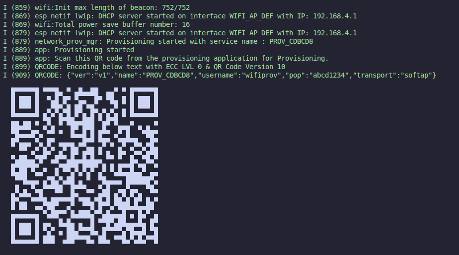

</div>

<div align="center">


</div>

<div align="center">

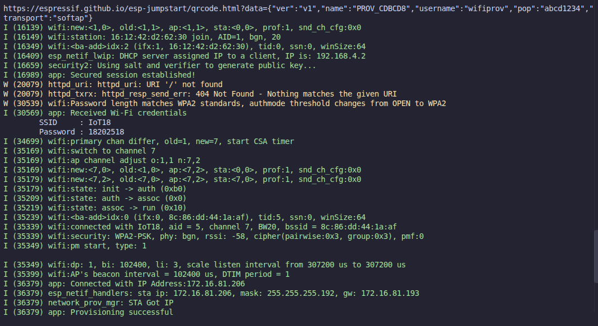

</div>

#### BLE

<div align="center">

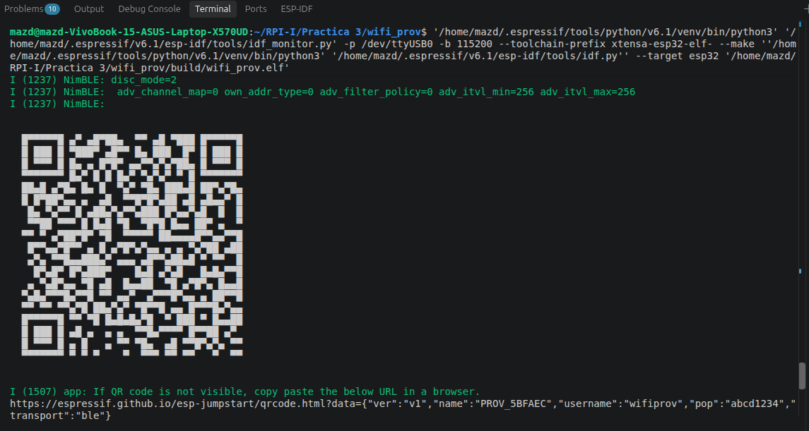

</div>

<div align="center">

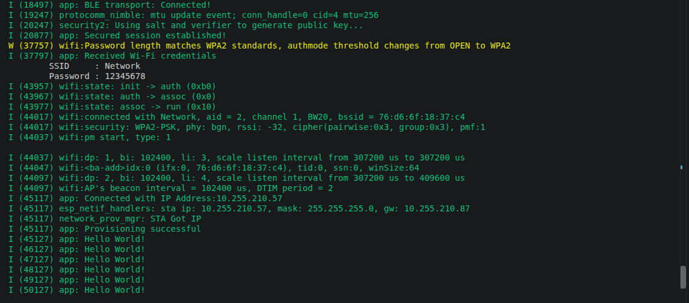

</div>


### Ejercicio 2

Revisa el código del ejemplo e identifica y explica las variables y los valores utilizados para cada uno de los niveles de seguridad (pista: consulta la llamada a network_prov_mgr_start_provisioning()).


En el ejemplo, el nivel de seguridad se selecciona con la variable `security` y se envía en la llamada:

```c
network_prov_mgr_start_provisioning(
	security,                   // nivel de seguridad
	(const void *) sec_params,  // parametros de ese nivel
	service_name,               // nombre del servicio
	service_key                 // clave del SoftAP
);
```

Los tres niveles disponibles son:

- **Seguridad 0 (`NETWORK_PROV_SECURITY_0 = 0`)**: no hay seguridad; la comunicación es en texto plano. `security` toma el valor `NETWORK_PROV_SECURITY_0`, `pop` vale `NULL` y `sec_params` también queda en `NULL`.
- **Seguridad 1 (`NETWORK_PROV_SECURITY_1 = 1`)**: realiza un intercambio de claves y utiliza cifrado AES-CTR. Puede utilizar una prueba de posesión (*proof of possession*, PoP). En el ejemplo, `security` toma el valor `NETWORK_PROV_SECURITY_1`, `pop` vale `"abcd1234"` y `sec_params` apunta a ese PoP.
- **Seguridad 2 (`NETWORK_PROV_SECURITY_2 = 2`)**: utiliza autenticación e intercambio de claves SRP6a y cifrado AES-GCM. `security` toma el valor `NETWORK_PROV_SECURITY_2`. `sec2_params` contiene `salt`, `salt_len`, `verifier` y `verifier_len`; estos datos se obtienen con `example_get_sec2_salt()` y `example_get_sec2_verifier()`, y `sec_params` apunta a `sec2_params`.

En el modo de desarrollo de seguridad 2, el código define `EXAMPLE_PROV_SEC2_USERNAME` como `"wifiprov"` y `EXAMPLE_PROV_SEC2_PWD` como `"abcd1234"`. Estos valores se utilizan para generar el *salt* y el *verifier*.

Las variables comunes de la llamada son `service_name` y `service_key`. `service_name` se genera con la dirección MAC y tiene el formato `PROV_XXXXXX`; es el SSID del SoftAP o el nombre del dispositivo cuando se usa BLE. `service_key` vale `NULL`: en BLE se ignora y en SoftAP significa que el punto de acceso no tiene una contraseña adicional. 


### Ejercicio 3

Modifica el código del ejemplo para forzar el nivel de seguridad 0 y realiza el aprovisionamiento mediante SoftAP utilizando esp_prov.py. Captura el tráfico de red con Wireshark y comprueba que las credenciales se envían sin cifrar. Después, vuelve a configurar el nivel de seguridad 2, repite el proceso y observa cómo las claves se intercambian cifradas.

Primero, hay que implementar un nivel de seguridad 0 que falta en el código. Podemos usar el marco de seguridad 1, cambiando sus variables de su función a NULL.

<div align="center">

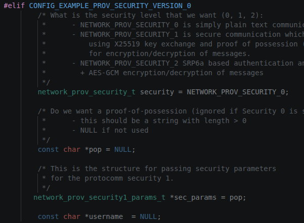

</div>

También hay que añadir el menú correspondiente en el manuconfig para poder ver o seleccionar la opción en este menú

<div align="center">

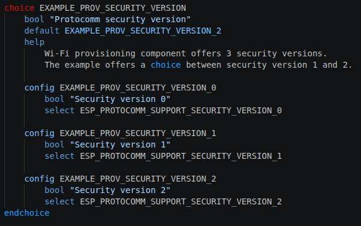

</div>

<div align="center">

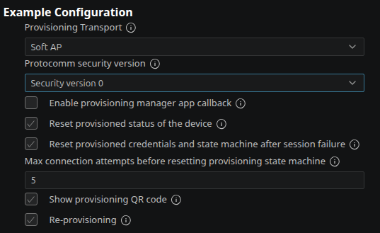

</div>

ahora, podemos comprobarlo usando el commando con esp_prov.py en un terminal

<div align="center">

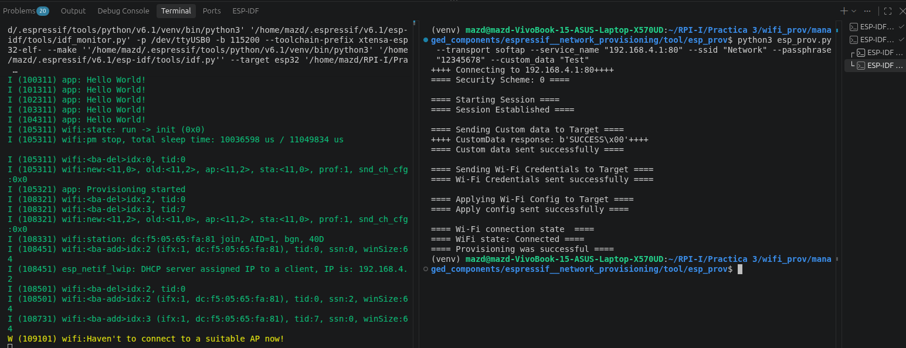

</div>

y al usar Wireshark, vimos que las credenciales se ven claramente

<div align="center">

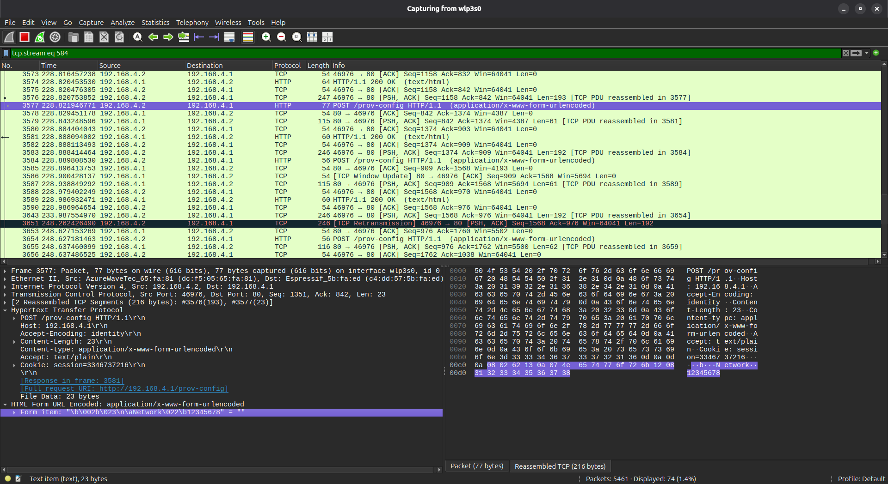

</div>

ahora volvemos al nivel 2 de seguridad

<div align="center">

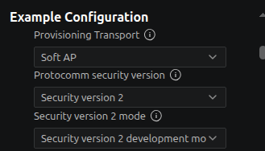

</div>

<div align="center">

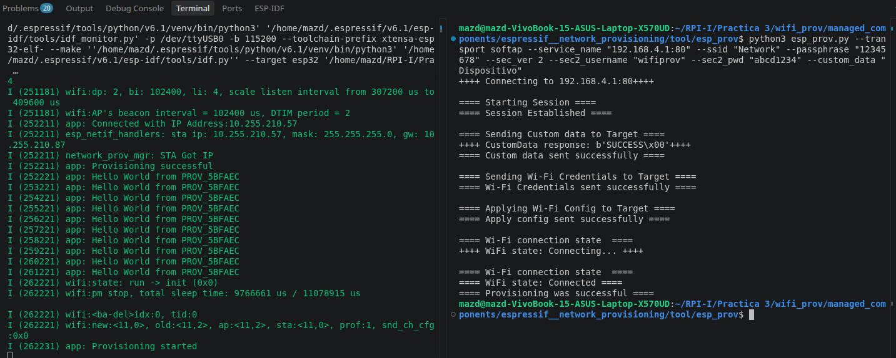

</div>

y usando Wireshark, se puede ver que la información viene cifrada

<div align="center">

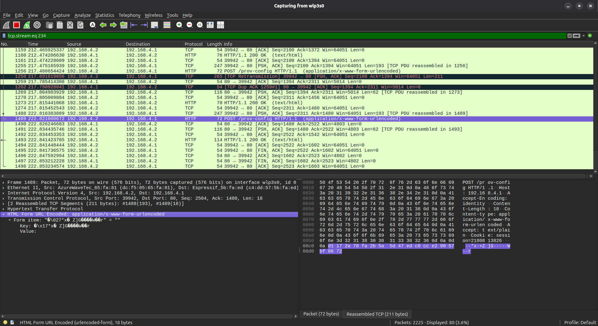

</div>

### Ejercicio 4

Realiza el aprovisionamiento mediante BLE o SoftAP y utiliza el parámetro --custom_data de esp_prov.py para enviar un nombre de dispositivo. Antes, modifica el programa para que en el bucle principal se muestre el mensaje "Hello world from ...", sustituyendo los puntos suspensivos por el nombre recibido durante el aprovisionamiento. Captura el tráfico de red con Wireshark e identifica el paquete que contiene el nombre del dispositivo.

Dentro de main_app() creamos una variable de tipo “char” para guardar el nombre del dispositivo, y después usamos la funcion “get_device_service_name()” con esta variable para tener el nombre.

<div align="center">

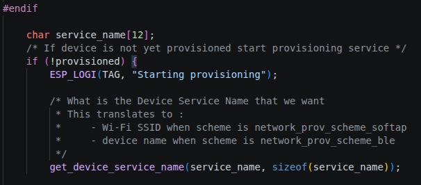

</div>

por último, cambiamos un poco el loop del código para mostrar el mensaje deseado.

<div align="center">

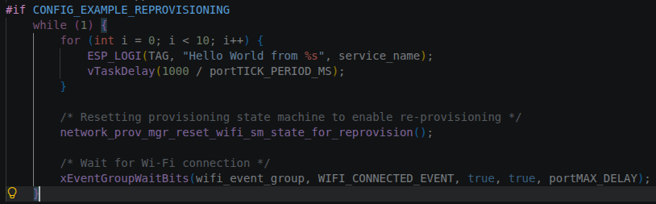

</div>

<div align="center">


</div>

### Ejercicio 5

Compila, flashea y ejecuta el ejemplo power_save utilizando los tres modos disponibles: sin ahorro energético, con ahorro mínimo y con ahorro máximo. En todos los casos, conecta el ESP32 a un punto de acceso y, desde un portátil conectado al mismo AP, ejecuta diferentes pings dirigidos al ESP32 y observa cómo varía el tiempo de respuesta. En el modo de ahorro máximo, prueba distintos intervalos de escucha y comprueba cómo afectan a los tiempos de respuesta de los pings.

Para cada modo, representa gráficamente el tiempo de respuesta de los pings. Relaciona los resultados con los intervalos DTIM y de escucha y discute los resultados obtenidos.

Comando para cambiar la configuracion

```bash
idf.py menuconfig
```

<div align="center">

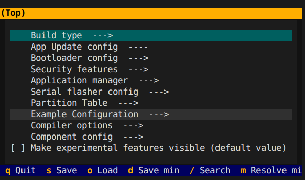

</div>

Comandos para construir y fashar

```bash
idf.py build
```

```bash
idf.py -p /dev/ttyUSB0 flash monitor
```

Método: sin ahorro energético

<div align="center">

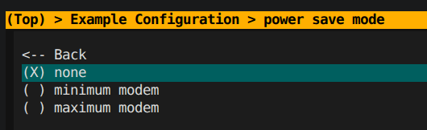

</div>

Conectamos la placa al ap

<div align="center">

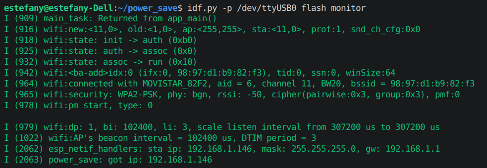

</div>

```text
PING 192.168.1.146 (192.168.1.146) 56(84) bytes of data.
64 bytes from 192.168.1.146: icmp_seq=1 ttl=64 time=321 ms
64 bytes from 192.168.1.146: icmp_seq=2 ttl=64 time=15.8 ms
64 bytes from 192.168.1.146: icmp_seq=3 ttl=64 time=4.47 ms
64 bytes from 192.168.1.146: icmp_seq=4 ttl=64 time=34.9 ms
64 bytes from 192.168.1.146: icmp_seq=5 ttl=64 time=4.48 ms
64 bytes from 192.168.1.146: icmp_seq=6 ttl=64 time=4.63 ms
64 bytes from 192.168.1.146: icmp_seq=7 ttl=64 time=5.22 ms
64 bytes from 192.168.1.146: icmp_seq=8 ttl=64 time=4.65 ms
64 bytes from 192.168.1.146: icmp_seq=9 ttl=64 time=4.72 ms
64 bytes from 192.168.1.146: icmp_seq=10 ttl=64 time=6.71 ms
64 bytes from 192.168.1.146: icmp_seq=11 ttl=64 time=4.60 ms
64 bytes from 192.168.1.146: icmp_seq=12 ttl=64 time=4.68 ms
64 bytes from 192.168.1.146: icmp_seq=13 ttl=64 time=4.63 ms
64 bytes from 192.168.1.146: icmp_seq=14 ttl=64 time=4.51 ms
64 bytes from 192.168.1.146: icmp_seq=15 ttl=64 time=4.22 ms
64 bytes from 192.168.1.146: icmp_seq=16 ttl=64 time=2.96 ms
64 bytes from 192.168.1.146: icmp_seq=17 ttl=64 time=2.76 ms
64 bytes from 192.168.1.146: icmp_seq=18 ttl=64 time=4.59 ms
64 bytes from 192.168.1.146: icmp_seq=19 ttl=64 time=4.55 ms
64 bytes from 192.168.1.146: icmp_seq=20 ttl=64 time=4.87 ms
64 bytes from 192.168.1.146: icmp_seq=21 ttl=64 time=4.56 ms
64 bytes from 192.168.1.146: icmp_seq=22 ttl=64 time=5.50 ms
64 bytes from 192.168.1.146: icmp_seq=23 ttl=64 time=4.66 ms
64 bytes from 192.168.1.146: icmp_seq=24 ttl=64 time=4.48 ms
64 bytes from 192.168.1.146: icmp_seq=25 ttl=64 time=6.06 ms
64 bytes from 192.168.1.146: icmp_seq=26 ttl=64 time=4.61 ms
64 bytes from 192.168.1.146: icmp_seq=27 ttl=64 time=4.37 ms
64 bytes from 192.168.1.146: icmp_seq=28 ttl=64 time=4.61 ms
64 bytes from 192.168.1.146: icmp_seq=29 ttl=64 time=4.50 ms
64 bytes from 192.168.1.146: icmp_seq=30 ttl=64 time=4.51 ms
64 bytes from 192.168.1.146: icmp_seq=31 ttl=64 time=29.7 ms
64 bytes from 192.168.1.146: icmp_seq=32 ttl=64 time=36.5 ms
64 bytes from 192.168.1.146: icmp_seq=33 ttl=64 time=7.56 ms
64 bytes from 192.168.1.146: icmp_seq=34 ttl=64 time=4.80 ms
64 bytes from 192.168.1.146: icmp_seq=35 ttl=64 time=4.89 ms
64 bytes from 192.168.1.146: icmp_seq=36 ttl=64 time=3.16 ms
64 bytes from 192.168.1.146: icmp_seq=37 ttl=64 time=4.52 ms
64 bytes from 192.168.1.146: icmp_seq=38 ttl=64 time=4.70 ms
64 bytes from 192.168.1.146: icmp_seq=39 ttl=64 time=4.52 ms
64 bytes from 192.168.1.146: icmp_seq=40 ttl=64 time=4.62 ms
64 bytes from 192.168.1.146: icmp_seq=41 ttl=64 time=4.61 ms
64 bytes from 192.168.1.146: icmp_seq=42 ttl=64 time=4.62 ms
64 bytes from 192.168.1.146: icmp_seq=43 ttl=64 time=20.6 ms
64 bytes from 192.168.1.146: icmp_seq=44 ttl=64 time=4.51 ms
64 bytes from 192.168.1.146: icmp_seq=45 ttl=64 time=6.22 ms
64 bytes from 192.168.1.146: icmp_seq=46 ttl=64 time=4.42 ms
64 bytes from 192.168.1.146: icmp_seq=47 ttl=64 time=2.77 ms
64 bytes from 192.168.1.146: icmp_seq=48 ttl=64 time=4.51 ms
64 bytes from 192.168.1.146: icmp_seq=49 ttl=64 time=6.10 ms
64 bytes from 192.168.1.146: icmp_seq=50 ttl=64 time=4.42 ms
64 bytes from 192.168.1.146: icmp_seq=51 ttl=64 time=4.50 ms
64 bytes from 192.168.1.146: icmp_seq=52 ttl=64 time=15.7 ms
64 bytes from 192.168.1.146: icmp_seq=53 ttl=64 time=5.14 ms
64 bytes from 192.168.1.146: icmp_seq=54 ttl=64 time=4.72 ms
64 bytes from 192.168.1.146: icmp_seq=55 ttl=64 time=28.0 ms
64 bytes from 192.168.1.146: icmp_seq=56 ttl=64 time=4.43 ms
64 bytes from 192.168.1.146: icmp_seq=57 ttl=64 time=17.4 ms
64 bytes from 192.168.1.146: icmp_seq=58 ttl=64 time=6.93 ms
64 bytes from 192.168.1.146: icmp_seq=59 ttl=64 time=6.16 ms
64 bytes from 192.168.1.146: icmp_seq=60 ttl=64 time=4.45 ms
64 bytes from 192.168.1.146: icmp_seq=61 ttl=64 time=4.59 ms
64 bytes from 192.168.1.146: icmp_seq=62 ttl=64 time=18.8 ms
64 bytes from 192.168.1.146: icmp_seq=63 ttl=64 time=4.29 ms
64 bytes from 192.168.1.146: icmp_seq=64 ttl=64 time=23.5 ms
64 bytes from 192.168.1.146: icmp_seq=65 ttl=64 time=4.40 ms
64 bytes from 192.168.1.146: icmp_seq=66 ttl=64 time=4.39 ms
64 bytes from 192.168.1.146: icmp_seq=67 ttl=64 time=6.05 ms
64 bytes from 192.168.1.146: icmp_seq=68 ttl=64 time=4.34 ms
64 bytes from 192.168.1.146: icmp_seq=69 ttl=64 time=4.43 ms
64 bytes from 192.168.1.146: icmp_seq=70 ttl=64 time=14.4 ms
64 bytes from 192.168.1.146: icmp_seq=71 ttl=64 time=4.55 ms
64 bytes from 192.168.1.146: icmp_seq=72 ttl=64 time=5.61 ms
64 bytes from 192.168.1.146: icmp_seq=73 ttl=64 time=4.66 ms
64 bytes from 192.168.1.146: icmp_seq=74 ttl=64 time=2.83 ms
64 bytes from 192.168.1.146: icmp_seq=75 ttl=64 time=3.51 ms
64 bytes from 192.168.1.146: icmp_seq=76 ttl=64 time=6.17 ms
64 bytes from 192.168.1.146: icmp_seq=77 ttl=64 time=5.08 ms
64 bytes from 192.168.1.146: icmp_seq=78 ttl=64 time=4.75 ms
64 bytes from 192.168.1.146: icmp_seq=79 ttl=64 time=4.57 ms
64 bytes from 192.168.1.146: icmp_seq=80 ttl=64 time=4.53 ms
64 bytes from 192.168.1.146: icmp_seq=81 ttl=64 time=4.89 ms
64 bytes from 192.168.1.146: icmp_seq=82 ttl=64 time=4.63 ms
64 bytes from 192.168.1.146: icmp_seq=83 ttl=64 time=49.2 ms
64 bytes from 192.168.1.146: icmp_seq=84 ttl=64 time=4.42 ms
64 bytes from 192.168.1.146: icmp_seq=85 ttl=64 time=7.92 ms
64 bytes from 192.168.1.146: icmp_seq=86 ttl=64 time=4.60 ms
64 bytes from 192.168.1.146: icmp_seq=87 ttl=64 time=2.82 ms
64 bytes from 192.168.1.146: icmp_seq=88 ttl=64 time=3.16 ms
64 bytes from 192.168.1.146: icmp_seq=89 ttl=64 time=2.93 ms
64 bytes from 192.168.1.146: icmp_seq=90 ttl=64 time=4.43 ms
64 bytes from 192.168.1.146: icmp_seq=91 ttl=64 time=39.0 ms
64 bytes from 192.168.1.146: icmp_seq=92 ttl=64 time=4.49 ms
64 bytes from 192.168.1.146: icmp_seq=93 ttl=64 time=2.79 ms
64 bytes from 192.168.1.146: icmp_seq=94 ttl=64 time=4.62 ms
64 bytes from 192.168.1.146: icmp_seq=95 ttl=64 time=4.43 ms
64 bytes from 192.168.1.146: icmp_seq=96 ttl=64 time=3.03 ms
64 bytes from 192.168.1.146: icmp_seq=97 ttl=64 time=4.68 ms
64 bytes from 192.168.1.146: icmp_seq=98 ttl=64 time=18.4 ms
64 bytes from 192.168.1.146: icmp_seq=99 ttl=64 time=4.92 ms
64 bytes from 192.168.1.146: icmp_seq=100 ttl=64 time=21.4 ms
--- 192.168.1.146 ping statistics ---
100 packets transmitted, 100 received, 0% packet loss, time 99084ms
rtt min/avg/max/mdev = 2.761/10.941/321.103/32.296 ms
```
Método: con ahorro mínimo

<div align="center">

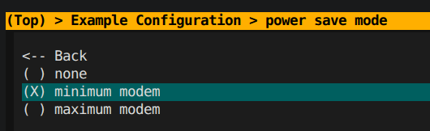

</div>

```text
PING 192.168.1.146 (192.168.1.146) 56(84) bytes of data.
64 bytes from 192.168.1.146: icmp_seq=1 ttl=64 time=569 ms
64 bytes from 192.168.1.146: icmp_seq=2 ttl=64 time=84.6 ms
64 bytes from 192.168.1.146: icmp_seq=3 ttl=64 time=411 ms
64 bytes from 192.168.1.146: icmp_seq=4 ttl=64 time=333 ms
64 bytes from 192.168.1.146: icmp_seq=5 ttl=64 time=255 ms
64 bytes from 192.168.1.146: icmp_seq=6 ttl=64 time=76.7 ms
64 bytes from 192.168.1.146: icmp_seq=7 ttl=64 time=304 ms
64 bytes from 192.168.1.146: icmp_seq=8 ttl=64 time=323 ms
64 bytes from 192.168.1.146: icmp_seq=9 ttl=64 time=53.9 ms
64 bytes from 192.168.1.146: icmp_seq=10 ttl=64 time=68.0 ms
64 bytes from 192.168.1.146: icmp_seq=11 ttl=64 time=393 ms
64 bytes from 192.168.1.146: icmp_seq=12 ttl=64 time=216 ms
64 bytes from 192.168.1.146: icmp_seq=13 ttl=64 time=136 ms
64 bytes from 192.168.1.146: icmp_seq=14 ttl=64 time=56.3 ms
64 bytes from 192.168.1.146: icmp_seq=15 ttl=64 time=485 ms
64 bytes from 192.168.1.146: icmp_seq=16 ttl=64 time=305 ms
64 bytes from 192.168.1.146: icmp_seq=17 ttl=64 time=227 ms
64 bytes from 192.168.1.146: icmp_seq=18 ttl=64 time=49.3 ms
64 bytes from 192.168.1.146: icmp_seq=19 ttl=64 time=376 ms
64 bytes from 192.168.1.146: icmp_seq=20 ttl=64 time=298 ms
64 bytes from 192.168.1.146: icmp_seq=21 ttl=64 time=220 ms
64 bytes from 192.168.1.146: icmp_seq=22 ttl=64 time=55.8 ms
64 bytes from 192.168.1.146: icmp_seq=23 ttl=64 time=367 ms
64 bytes from 192.168.1.146: icmp_seq=24 ttl=64 time=289 ms
64 bytes from 192.168.1.146: icmp_seq=25 ttl=64 time=209 ms
64 bytes from 192.168.1.146: icmp_seq=26 ttl=64 time=34.9 ms
64 bytes from 192.168.1.146: icmp_seq=27 ttl=64 time=264 ms
64 bytes from 192.168.1.146: icmp_seq=28 ttl=64 time=280 ms
64 bytes from 192.168.1.146: icmp_seq=29 ttl=64 time=201 ms
64 bytes from 192.168.1.146: icmp_seq=30 ttl=64 time=23.2 ms
64 bytes from 192.168.1.146: icmp_seq=31 ttl=64 time=350 ms
64 bytes from 192.168.1.146: icmp_seq=32 ttl=64 time=272 ms
64 bytes from 192.168.1.146: icmp_seq=33 ttl=64 time=94.2 ms
64 bytes from 192.168.1.146: icmp_seq=34 ttl=64 time=15.1 ms
64 bytes from 192.168.1.146: icmp_seq=35 ttl=64 time=341 ms
64 bytes from 192.168.1.146: icmp_seq=36 ttl=64 time=167 ms
64 bytes from 192.168.1.146: icmp_seq=37 ttl=64 time=84.6 ms
64 bytes from 192.168.1.146: icmp_seq=38 ttl=64 time=411 ms
64 bytes from 192.168.1.146: icmp_seq=39 ttl=64 time=333 ms
64 bytes from 192.168.1.146: icmp_seq=40 ttl=64 time=254 ms
64 bytes from 192.168.1.146: icmp_seq=41 ttl=64 time=78.7 ms
64 bytes from 192.168.1.146: icmp_seq=42 ttl=64 time=402 ms
64 bytes from 192.168.1.146: icmp_seq=43 ttl=64 time=324 ms
64 bytes from 192.168.1.146: icmp_seq=44 ttl=64 time=247 ms
64 bytes from 192.168.1.146: icmp_seq=45 ttl=64 time=67.6 ms
64 bytes from 192.168.1.146: icmp_seq=46 ttl=64 time=394 ms
64 bytes from 192.168.1.146: icmp_seq=47 ttl=64 time=259 ms
64 bytes from 192.168.1.146: icmp_seq=48 ttl=64 time=236 ms
64 bytes from 192.168.1.146: icmp_seq=49 ttl=64 time=58.1 ms
64 bytes from 192.168.1.146: icmp_seq=50 ttl=64 time=386 ms
64 bytes from 192.168.1.146: icmp_seq=51 ttl=64 time=307 ms
64 bytes from 192.168.1.146: icmp_seq=52 ttl=64 time=229 ms
64 bytes from 192.168.1.146: icmp_seq=53 ttl=64 time=51.0 ms
64 bytes from 192.168.1.146: icmp_seq=54 ttl=64 time=378 ms
64 bytes from 192.168.1.146: icmp_seq=55 ttl=64 time=300 ms
64 bytes from 192.168.1.146: icmp_seq=56 ttl=64 time=222 ms
64 bytes from 192.168.1.146: icmp_seq=57 ttl=64 time=43.4 ms
64 bytes from 192.168.1.146: icmp_seq=58 ttl=64 time=270 ms
64 bytes from 192.168.1.146: icmp_seq=59 ttl=64 time=291 ms
64 bytes from 192.168.1.146: icmp_seq=60 ttl=64 time=213 ms
64 bytes from 192.168.1.146: icmp_seq=61 ttl=64 time=35.2 ms
64 bytes from 192.168.1.146: icmp_seq=62 ttl=64 time=302 ms
64 bytes from 192.168.1.146: icmp_seq=63 ttl=64 time=284 ms
64 bytes from 192.168.1.146: icmp_seq=64 ttl=64 time=105 ms
64 bytes from 192.168.1.146: icmp_seq=65 ttl=64 time=25.4 ms
64 bytes from 192.168.1.146: icmp_seq=66 ttl=64 time=352 ms
64 bytes from 192.168.1.146: icmp_seq=67 ttl=64 time=273 ms
64 bytes from 192.168.1.146: icmp_seq=68 ttl=64 time=94.6 ms
64 bytes from 192.168.1.146: icmp_seq=69 ttl=64 time=14.1 ms
64 bytes from 192.168.1.146: icmp_seq=70 ttl=64 time=341 ms
64 bytes from 192.168.1.146: icmp_seq=71 ttl=64 time=78.5 ms
64 bytes from 192.168.1.146: icmp_seq=72 ttl=64 time=85.9 ms
64 bytes from 192.168.1.146: icmp_seq=73 ttl=64 time=412 ms
64 bytes from 192.168.1.146: icmp_seq=74 ttl=64 time=333 ms
64 bytes from 192.168.1.146: icmp_seq=75 ttl=64 time=254 ms
64 bytes from 192.168.1.146: icmp_seq=76 ttl=64 time=75.2 ms
64 bytes from 192.168.1.146: icmp_seq=77 ttl=64 time=402 ms
64 bytes from 192.168.1.146: icmp_seq=78 ttl=64 time=324 ms
64 bytes from 192.168.1.146: icmp_seq=79 ttl=64 time=245 ms
64 bytes from 192.168.1.146: icmp_seq=80 ttl=64 time=67.8 ms
64 bytes from 192.168.1.146: icmp_seq=81 ttl=64 time=393 ms
64 bytes from 192.168.1.146: icmp_seq=82 ttl=64 time=315 ms
64 bytes from 192.168.1.146: icmp_seq=83 ttl=64 time=237 ms
64 bytes from 192.168.1.146: icmp_seq=84 ttl=64 time=466 ms
64 bytes from 192.168.1.146: icmp_seq=85 ttl=64 time=388 ms
64 bytes from 192.168.1.146: icmp_seq=86 ttl=64 time=309 ms
64 bytes from 192.168.1.146: icmp_seq=87 ttl=64 time=240 ms
64 bytes from 192.168.1.146: icmp_seq=88 ttl=64 time=459 ms
64 bytes from 192.168.1.146: icmp_seq=89 ttl=64 time=381 ms
64 bytes from 192.168.1.146: icmp_seq=90 ttl=64 time=302 ms
64 bytes from 192.168.1.146: icmp_seq=91 ttl=64 time=224 ms
64 bytes from 192.168.1.146: icmp_seq=92 ttl=64 time=48.7 ms
64 bytes from 192.168.1.146: icmp_seq=93 ttl=64 time=372 ms
64 bytes from 192.168.1.146: icmp_seq=94 ttl=64 time=293 ms
64 bytes from 192.168.1.146: icmp_seq=95 ttl=64 time=215 ms
64 bytes from 192.168.1.146: icmp_seq=96 ttl=64 time=41.5 ms
64 bytes from 192.168.1.146: icmp_seq=97 ttl=64 time=314 ms
64 bytes from 192.168.1.146: icmp_seq=98 ttl=64 time=286 ms
64 bytes from 192.168.1.146: icmp_seq=99 ttl=64 time=206 ms
64 bytes from 192.168.1.146: icmp_seq=100 ttl=64 time=28.6 ms
--- 192.168.1.146 ping statistics ---
100 packets transmitted, 100 received, 0% packet loss, time 99053ms
rtt min/avg/max/mdev = 14.074/236.655/569.192/132.708 ms
```
Método: con ahorro máximo

<div align="center">

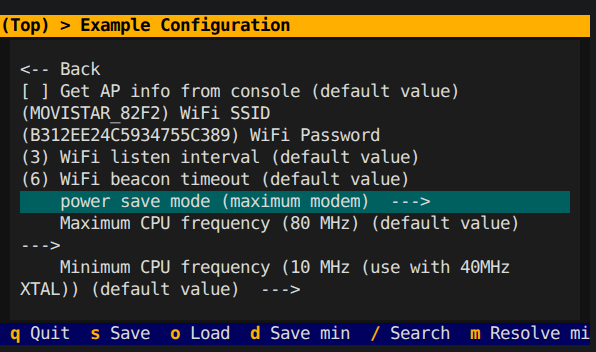

</div>

<div align="center">

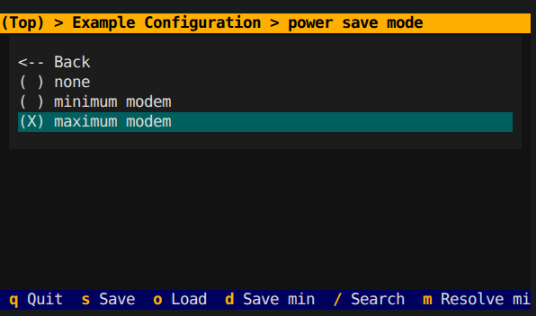

</div>

```text
PING 192.168.1.146 (192.168.1.146) 56(84) bytes of data.
64 bytes from 192.168.1.146: icmp_seq=1 ttl=64 time=655 ms
64 bytes from 192.168.1.146: icmp_seq=2 ttl=64 time=269 ms
64 bytes from 192.168.1.146: icmp_seq=3 ttl=64 time=91.2 ms
64 bytes from 192.168.1.146: icmp_seq=4 ttl=64 time=11.0 ms
64 bytes from 192.168.1.146: icmp_seq=5 ttl=64 time=338 ms
64 bytes from 192.168.1.146: icmp_seq=6 ttl=64 time=159 ms
64 bytes from 192.168.1.146: icmp_seq=7 ttl=64 time=79.0 ms
64 bytes from 192.168.1.146: icmp_seq=8 ttl=64 time=406 ms
64 bytes from 192.168.1.146: icmp_seq=9 ttl=64 time=325 ms
64 bytes from 192.168.1.146: icmp_seq=10 ttl=64 time=246 ms
64 bytes from 192.168.1.146: icmp_seq=11 ttl=64 time=67.4 ms
64 bytes from 192.168.1.146: icmp_seq=12 ttl=64 time=394 ms
64 bytes from 192.168.1.146: icmp_seq=13 ttl=64 time=315 ms
64 bytes from 192.168.1.146: icmp_seq=14 ttl=64 time=236 ms
64 bytes from 192.168.1.146: icmp_seq=15 ttl=64 time=57.0 ms
64 bytes from 192.168.1.146: icmp_seq=16 ttl=64 time=384 ms
64 bytes from 192.168.1.146: icmp_seq=17 ttl=64 time=221 ms
64 bytes from 192.168.1.146: icmp_seq=18 ttl=64 time=53.7 ms
64 bytes from 192.168.1.146: icmp_seq=19 ttl=64 time=452 ms
64 bytes from 192.168.1.146: icmp_seq=20 ttl=64 time=374 ms
64 bytes from 192.168.1.146: icmp_seq=21 ttl=64 time=293 ms
64 bytes from 192.168.1.146: icmp_seq=22 ttl=64 time=114 ms
64 bytes from 192.168.1.146: icmp_seq=23 ttl=64 time=34.8 ms
64 bytes from 192.168.1.146: icmp_seq=24 ttl=64 time=361 ms
64 bytes from 192.168.1.146: icmp_seq=25 ttl=64 time=282 ms
64 bytes from 192.168.1.146: icmp_seq=26 ttl=64 time=201 ms
64 bytes from 192.168.1.146: icmp_seq=27 ttl=64 time=22.9 ms
64 bytes from 192.168.1.146: icmp_seq=28 ttl=64 time=363 ms
64 bytes from 192.168.1.146: icmp_seq=29 ttl=64 time=94.9 ms
64 bytes from 192.168.1.146: icmp_seq=30 ttl=64 time=109 ms
64 bytes from 192.168.1.146: icmp_seq=31 ttl=64 time=320 ms
64 bytes from 192.168.1.146: icmp_seq=32 ttl=64 time=339 ms
64 bytes from 192.168.1.146: icmp_seq=33 ttl=64 time=259 ms
64 bytes from 192.168.1.146: icmp_seq=34 ttl=64 time=87.2 ms
64 bytes from 192.168.1.146: icmp_seq=35 ttl=64 time=426 ms
64 bytes from 192.168.1.146: icmp_seq=36 ttl=64 time=323 ms
64 bytes from 192.168.1.146: icmp_seq=37 ttl=64 time=249 ms
64 bytes from 192.168.1.146: icmp_seq=38 ttl=64 time=69.6 ms
64 bytes from 192.168.1.146: icmp_seq=39 ttl=64 time=307 ms
64 bytes from 192.168.1.146: icmp_seq=40 ttl=64 time=318 ms
64 bytes from 192.168.1.146: icmp_seq=41 ttl=64 time=237 ms
64 bytes from 192.168.1.146: icmp_seq=42 ttl=64 time=60.7 ms
64 bytes from 192.168.1.146: icmp_seq=43 ttl=64 time=384 ms
64 bytes from 192.168.1.146: icmp_seq=44 ttl=64 time=316 ms
64 bytes from 192.168.1.146: icmp_seq=45 ttl=64 time=55.9 ms
64 bytes from 192.168.1.146: icmp_seq=46 ttl=64 time=47.3 ms
64 bytes from 192.168.1.146: icmp_seq=47 ttl=64 time=272 ms
64 bytes from 192.168.1.146: icmp_seq=48 ttl=64 time=295 ms
64 bytes from 192.168.1.146: icmp_seq=49 ttl=64 time=116 ms
64 bytes from 192.168.1.146: icmp_seq=50 ttl=64 time=37.4 ms
64 bytes from 192.168.1.146: icmp_seq=51 ttl=64 time=364 ms
64 bytes from 192.168.1.146: icmp_seq=52 ttl=64 time=186 ms
64 bytes from 192.168.1.146: icmp_seq=53 ttl=64 time=205 ms
64 bytes from 192.168.1.146: icmp_seq=54 ttl=64 time=27.3 ms
64 bytes from 192.168.1.146: icmp_seq=55 ttl=64 time=256 ms
64 bytes from 192.168.1.146: icmp_seq=56 ttl=64 time=95.7 ms
64 bytes from 192.168.1.146: icmp_seq=57 ttl=64 time=94.4 ms
64 bytes from 192.168.1.146: icmp_seq=58 ttl=64 time=18.9 ms
64 bytes from 192.168.1.146: icmp_seq=59 ttl=64 time=342 ms
64 bytes from 192.168.1.146: icmp_seq=60 ttl=64 time=262 ms
64 bytes from 192.168.1.146: icmp_seq=61 ttl=64 time=82.5 ms
64 bytes from 192.168.1.146: icmp_seq=62 ttl=64 time=410 ms
64 bytes from 192.168.1.146: icmp_seq=63 ttl=64 time=331 ms
64 bytes from 192.168.1.146: icmp_seq=64 ttl=64 time=152 ms
64 bytes from 192.168.1.146: icmp_seq=65 ttl=64 time=480 ms
64 bytes from 192.168.1.146: icmp_seq=66 ttl=64 time=401 ms
64 bytes from 192.168.1.146: icmp_seq=67 ttl=64 time=321 ms
64 bytes from 192.168.1.146: icmp_seq=68 ttl=64 time=242 ms
64 bytes from 192.168.1.146: icmp_seq=69 ttl=64 time=61.9 ms
64 bytes from 192.168.1.146: icmp_seq=70 ttl=64 time=389 ms
64 bytes from 192.168.1.146: icmp_seq=71 ttl=64 time=310 ms
64 bytes from 192.168.1.146: icmp_seq=72 ttl=64 time=229 ms
64 bytes from 192.168.1.146: icmp_seq=73 ttl=64 time=50.1 ms
64 bytes from 192.168.1.146: icmp_seq=74 ttl=64 time=278 ms
64 bytes from 192.168.1.146: icmp_seq=75 ttl=64 time=298 ms
64 bytes from 192.168.1.146: icmp_seq=76 ttl=64 time=219 ms
64 bytes from 192.168.1.146: icmp_seq=77 ttl=64 time=40.4 ms
64 bytes from 192.168.1.146: icmp_seq=78 ttl=64 time=373 ms
64 bytes from 192.168.1.146: icmp_seq=79 ttl=64 time=187 ms
64 bytes from 192.168.1.146: icmp_seq=80 ttl=64 time=207 ms
64 bytes from 192.168.1.146: icmp_seq=81 ttl=64 time=263 ms
64 bytes from 192.168.1.146: icmp_seq=82 ttl=64 time=367 ms
64 bytes from 192.168.1.146: icmp_seq=83 ttl=64 time=298 ms
64 bytes from 192.168.1.146: icmp_seq=84 ttl=64 time=506 ms
64 bytes from 192.168.1.146: icmp_seq=85 ttl=64 time=119 ms
64 bytes from 192.168.1.146: icmp_seq=86 ttl=64 time=381 ms
64 bytes from 192.168.1.146: icmp_seq=87 ttl=64 time=708 ms
64 bytes from 192.168.1.146: icmp_seq=88 ttl=64 time=509 ms
64 bytes from 192.168.1.146: icmp_seq=89 ttl=64 time=212 ms
64 bytes from 192.168.1.146: icmp_seq=90 ttl=64 time=337 ms
64 bytes from 192.168.1.146: icmp_seq=91 ttl=64 time=294 ms
64 bytes from 192.168.1.146: icmp_seq=92 ttl=64 time=180 ms
64 bytes from 192.168.1.146: icmp_seq=93 ttl=64 time=404 ms
64 bytes from 192.168.1.146: icmp_seq=94 ttl=64 time=325 ms
64 bytes from 192.168.1.146: icmp_seq=95 ttl=64 time=252 ms
64 bytes from 192.168.1.146: icmp_seq=96 ttl=64 time=172 ms
64 bytes from 192.168.1.146: icmp_seq=97 ttl=64 time=497 ms
64 bytes from 192.168.1.146: icmp_seq=98 ttl=64 time=315 ms
64 bytes from 192.168.1.146: icmp_seq=99 ttl=64 time=232 ms
64 bytes from 192.168.1.146: icmp_seq=100 ttl=64 time=74.8 ms
--- 192.168.1.146 ping statistics ---
100 packets transmitted, 100 received, 0% packet loss, time 99114ms
rtt min/avg/max/mdev = 11.013/248.844/708.332/144.160 ms
```
Para realizar la gráfica se procede a $install matplotlib de lo cual de los métodos se ha generado un archivo para cada método

Codigo de python3 para generar graficas

```python
import re

import statistics

import matplotlib.pyplot as plt

# Archivos de resultados de cada modo de ahorro

archivos = {

"Sin ahorro": "ping_none.txt",

"Ahorro mínimo": "ping_minimum.txt",

"Ahorro máximo": "ping_maximum.txt"

}

resultados = {}

print("\n===== RESULTADOS DE LAS PRUEBAS DE PING =====")

# Leer los archivos y extraer los tiempos de respuesta

for modo, archivo in archivos.items():

try:

with open(archivo, "r", encoding="utf-8") as f:

texto = f.read()

# Extrae tiempos como time=3.45 ms o time<1 ms

tiempos = [

float(t)

for t in re.findall(r"time[=<]([\d.]+)\s*ms", texto)

]

resultados[modo] = tiempos

print(f"\n--- {modo} ---")

print(f"Archivo: {archivo}")

print(f"Paquetes con respuesta: {len(tiempos)}")

# Leer estadísticas de pérdida si están en el archivo

perdida = re.search(

r"(\d+(?:\.\d+)?)%\s*packet loss", texto

)

if perdida:

print(f"Paquetes perdidos: {perdida.group(1)}%")

else:

print("Pérdida de paquetes: no disponible")

if tiempos:

print(f"Tiempo mínimo: {min(tiempos):.2f} ms")

print(f"Tiempo medio: {statistics.mean(tiempos):.2f} ms")

print(f"Tiempo máximo: {max(tiempos):.2f} ms")

if len(tiempos) > 1:

print(

f"Desviación estándar: "

f"{statistics.stdev(tiempos):.2f} ms"

)

else:

print("No se encontraron tiempos de respuesta.")

except FileNotFoundError:

print(f"\nERROR: no se encuentra el archivo {archivo}")

print("Comprueba que está en la misma carpeta que graficas.py.")

# Comprobar que hay datos para representar

modos_validos = [

modo for modo, tiempos in resultados.items() if tiempos

]

if not modos_validos:

print("\nNo hay datos para generar las gráficas.")

print("Comprueba el contenido de los archivos ping.")

raise SystemExit(1)

# GRÁFICA 1: evolución de los tiempos de respuesta

plt.figure(figsize=(11, 6))

for modo in modos_validos:

tiempos = resultados[modo]

plt.plot(

range(1, len(tiempos) + 1),

tiempos,

marker=".",

markersize=4,

label=modo

)

plt.xlabel("Número de respuesta recibida")

plt.ylabel("Tiempo de respuesta (ms)")

plt.title("Tiempos de respuesta del ESP32 según el modo Wi-Fi")

plt.legend()

plt.grid(True)

plt.tight_layout()

plt.savefig("comparacion_pings.png", dpi=150)

plt.close()

# GRÁFICA 2: comparación de los tiempos medios

medias = [

statistics.mean(resultados[modo])

for modo in modos_validos

]

plt.figure(figsize=(9, 5))

plt.bar(modos_validos, medias)

plt.ylabel("Tiempo medio de respuesta (ms)")

plt.title("Comparación del tiempo medio de ping")

plt.grid(axis="y")

plt.tight_layout()

plt.savefig("tiempos_medios.png", dpi=150)

plt.close()

print("\n===== GRÁFICAS GENERADAS =====")

print("1. comparacion_pings.png")

print("2. tiempos_medios.png")

print("\nBusca estas imágenes en la carpeta actual.")
```

Estas gráficas comparan los tiempos de respuesta de los tres modos.

<div align="center">

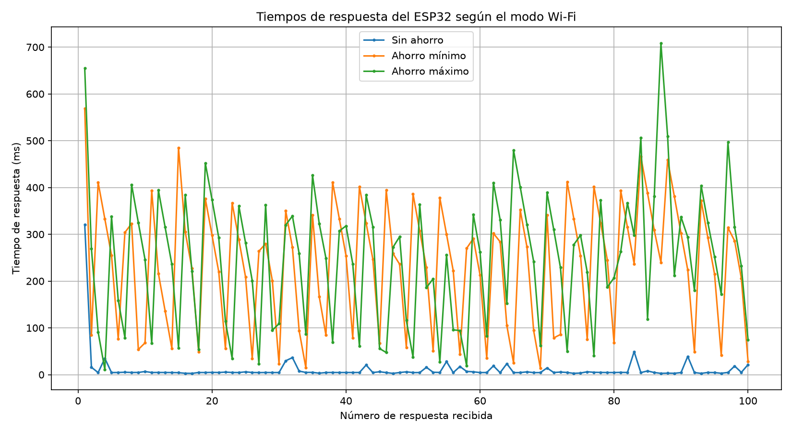

</div>

<div align="center">

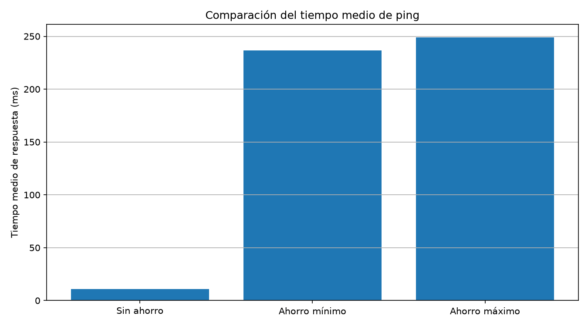

</div>

Comprobar los intervalos de escucha

Método: con ahorro máximo intervalo 1

<div align="center">

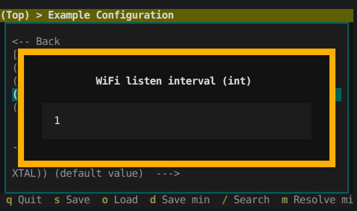

</div>

Método: con ahorro máximo intervalo 3

<div align="center">

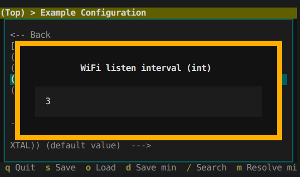

</div>

Método: con ahorro máximo intervalo 5

<div align="center">


</div>

<div align="center">

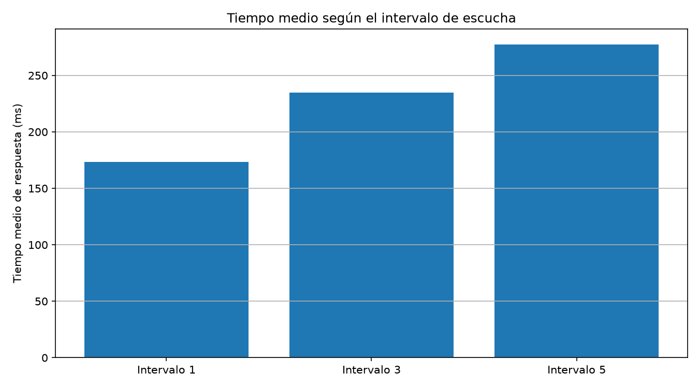

</div>

<div align="center">

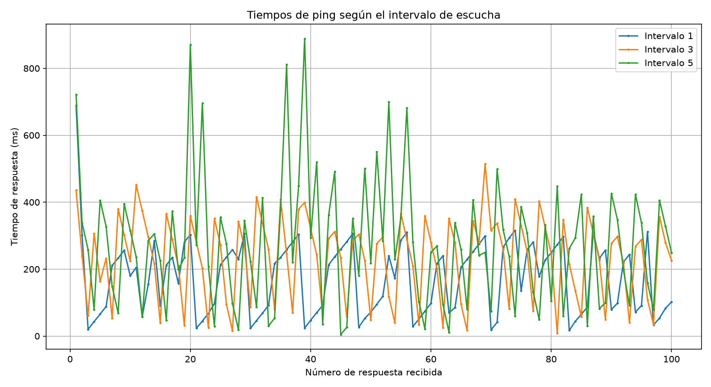

</div>

#### Resultados y discusión

Se han realizado pruebas de conectividad mediante 100 peticiones ICMP (ping) para los tres modos de ahorro energético Wi-Fi: sin ahorro de energía, ahorro mínimo y ahorro máximo.

En las tres pruebas se recibieron las 100 respuestas, por lo que la pérdida de paquetes fue del 0 %, se observó en el modo, sin ahorro energético el tiempo medio de 10,94 ms. En el modo de ahorro mínimo, el tiempo medio fue de 236,65 ms, mientras que en el modo de ahorro máximo alcanzó los 248,87 ms.

Estos resultados muestran que, durante las pruebas realizadas, los modos de ahorro energético presentaron una latencia media superior a la del modo sin ahorro, la desviación estándar fue mayor en ambos modos de ahorro, lo que indica una mayor dispersión de los tiempos de respuesta. Este comportamiento es compatible con las esperas que pueden producirse cuando el dispositivo utiliza mecanismos de ahorro energético.

También se analizó el efecto del intervalo de escucha en el modo de ahorro máximo. Para los intervalos 1, 3 y 5 se obtuvieron tiempos medios de 173,30 ms, 234,79 ms y 277,29 ms, de lo cual se observó un aumento de la latencia media al incrementar el intervalo de escucha. El valor máximo registrado fue de 888 ms para el intervalo 5.

El comportamiento observado puede relacionarse con el funcionamiento del ahorro energético Wi-Fi. El punto de acceso transmite balizas periódicas y utiliza la información DTIM para anunciar datos almacenados para la placa que se encuentran en ahorro energético. El intervalo de escucha determina la frecuencia con la que la placa espera escuchar las balizas, de acuerdo con la configuración Wi-Fi utilizada. Si el dispositivo tarda más en comprobar si hay datos pendientes, algunas comunicaciones pueden experimentar una mayor latencia.
