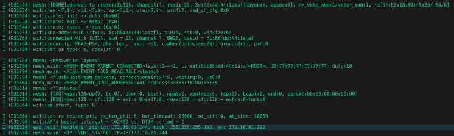
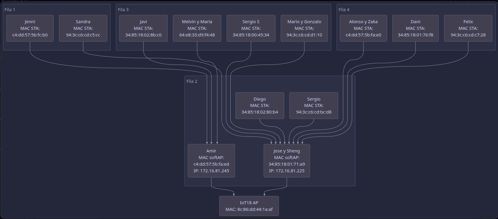
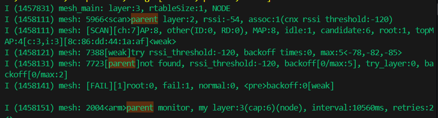
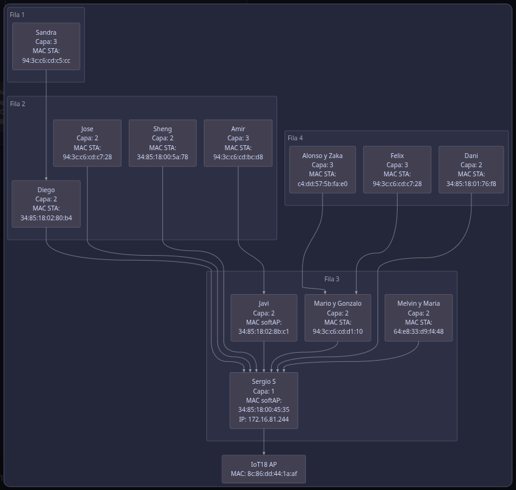
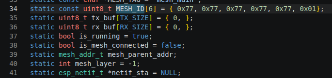
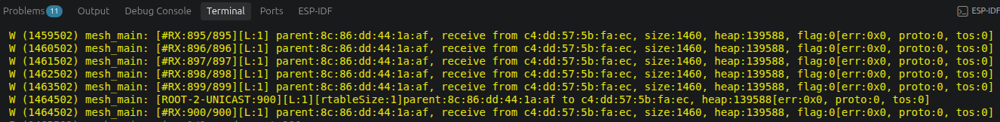
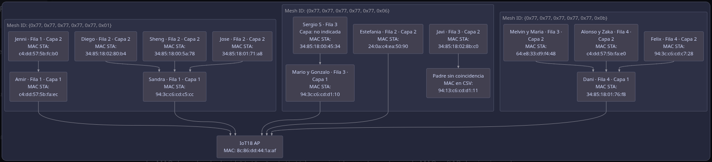

# Laboratorio de RPI I

Grupo: 7

Integrantes:

- Amirhosein Mozaffari

- Estefania Ruiz

- Sergio Romero Plasencia

Fecha: 01/11/2026

Número de laboratorio: 4

## Desarrollo de ejercicios

### Ejercicio 1

Captura el estado de la red cuando todos/as tus compañeros/as hayan llegado al estado de convergencia. Documenta el proceso y las salidas de tus nodos mesh, y representa la topología final mediante un grafo.

#### Estado de la red

Para comprobar la convergencia se dejó en ejecución el nodo mesh y se observaron periódicamente los mensajes del monitor serie. 

<div align="center">



*Conección del nodo padre*

</div>

La red permaneció estable durante la captura: el dispositivo se mantuvo como `NODE` en la capa 2, utilizando como padre el nodo `34:85:18:01:71:a9`. Además, se recibieron de forma continua tramas de 1460 bytes desde `34:85:18:01:71:a8`, sin errores de protocolo (`err:0x0`).

El nodo estaba asociado en el canal 7, con una señal de recepción entre -54 dBm y -62 dBm. La asociación mostraba seis dispositivos (`assoc:6`), lo que confirma que el nodo formaba parte de la red mesh. Los mensajes de monitorización del padre también indican que el nodo conservaba su relación en la capa 2 y no necesitaba cambiar de padre.

Una parte representativa de la salida:

```text
I (296441) mesh_main: layer:2, rtableSize:1, NODE
W (297311) mesh_main: [#RX:126/472][L:2] parent:34:85:18:01:71:a9, receive from 34:85:18:01:71:a8, size=1460, heap:156184, flag:0[err:0x0, proto:0, tos:0]
I (306441) mesh_main: layer:2, rtableSize:1, NODE
I (388391) mesh: 5127<assoc>parent layer:1, channel:7, rssi:-62, assoc:6, rssi threshold<-78,-82,-85>
I (452491) mesh: 5161<active>parent layer:1(node), channel:7, rssi:-54, assoc:6(cnx rssi threshold:-120)my_assoc:0
W (454561) mesh_main: [#RX:184/529][L:2] parent:34:85:18:01:71:a9, receive from 34:85:18:01:71:a8, size=1460, heap:156184, flag:0[err:0x0, proto:0, tos:0]
```

#### Topología

La topología final se representa en el siguiente grafo.

<div align="center">



*Topología de Red Mesh*

</div>

### Ejercicio 2 

Captura de nuevo el estado de la red cuando todos/as tus compañeros/as hayan llegado al estado de convergencia. Documenta el proceso y las salidas de tus nodos mesh, y representa la nueva topología final mediante un grafo.

#### Estado de la red

En esta segunda captura se dejó el nodo mesh en ejecución hasta que la red alcanzó de nuevo el estado de convergencia luego de que el nodo padre anterior se desconectó y se esperó a que la red se estabilizara. 

<div align="center">



*Desconexión del Nodo Padre*

</div>


A diferencia del ejercicio anterior, nuestro nodo se encontraba en la capa 3 (`layer:3`). Su padre directo era el nodo `34:85:18:02:8b:c1`, situado en la capa 2. A su vez, este nodo de capa 2 estaba conectado al padre de la red, `34:85:18:00:45:34`.

La estabilidad de la conexión se observa en la recepción consecutiva de tramas, cuyos contadores avanzan de `#RX:924/404` a `#RX:928/408`. Todas las tramas tenían un tamaño de 1460 bytes y se recibieron sin errores (`err:0x0`), por lo que la comunicación entre los niveles de la red era correcta.

Una parte representativa de la salida observada es:

```text
I (2536441) mesh_main: layer:3, rtableSize:1, NODE
W (2536451) mesh_main: [#RX:924/404][L:3] parent:34:85:18:02:8b:c1, receive from 34:85:18:00:45:34, size:1460, heap:154784, flag:0[err:0x0, proto:0, tos:0]
W (2537851) mesh_main: [#RX:925/405][L:3] parent:34:85:18:02:8b:c1, receive from 34:85:18:00:45:34, size:1460, heap:154784, flag:0[err:0x0, proto:0, tos:0]
W (2541131) mesh_main: [#RX:926/406][L:3] parent:34:85:18:02:8b:c1, receive from 34:85:18:00:45:34, size:1460, heap:154784, flag:0[err:0x0, proto:0, tos:0]
W (2543351) mesh_main: [#RX:927/407][L:3] parent:34:85:18:02:8b:c1, receive from 34:85:18:00:45:34, size:1460, heap:154784, flag:0[err:0x0, proto:0, tos:0]
W (2545031) mesh_main: [#RX:928/408][L:3] parent:34:85:18:02:8b:c1, receive from 34:85:18:00:45:34, size:1460, heap:154784, flag:0[err:0x0, proto:0, tos:0]
```

Por tanto, la nueva topología tiene tres niveles: el padre en la raíz, el nodo intermedio en la capa 2 y nuestro nodo en la capa 3.


#### Topología

La topología final se representa en el siguiente grafo.

<div align="center">



*Topología de Red Mesh*

</div>

### Ejercicio 3

Captura el estado de la red cuando los demás nodos de tu red mesh hayan llegado al estado de convergencia. Documenta el proceso y las salidas de tus nodos mesh, y representa la topología final mediante un grafo.

#### Estado de la red

En este ejercicio se creó una red mesh independiente para cada grupo de nodos. Aunque las tres redes utilizan el mismo punto de acceso físico (`IoT18 AP`, MAC `8c:86:dd:44:1a:af`), cada una tiene un `Mesh ID` diferente. Por tanto, los nodos solo pueden asociarse y encaminar tráfico dentro de la malla cuyo identificador coincide con su configuración.

<div align="center">



*Configuración de Mesh ID*

</div>


<div align="center">



*Salida como Nodo Raiz "Amir"*

</div>


La topología obtenida muestra las siguientes rutas después de la convergencia:

- En `Mesh01` (`...0x01`), Sandra, Diego, Sheng y Jose utilizan la contraseña correspondiente a la red principal. Amir y Jenni, aunque tienen el mismo `Mesh ID`, configuraron otra contraseña de red mesh. Por este motivo no pudieron asociarse a Sandra ni integrarse en su misma malla de forma normal; se conectaron entre sí, quedando Amir como padre de Jenni. Por tanto, el mismo identificador no fue suficiente para que todos los nodos formaran una única red, ya que la contraseña también debe coincidir.
- En `Mesh06` (`...0x06`), Estefania y Mario están conectados directamente al root. Sergio S utiliza a Mario como padre y aparece en la fila 3.
- En `Mesh0B` (`...0x0b`), Dani está conectado directamente al root. Melvin y Maria, Alonso y Zaka, y Felix utilizan a Dani como padre, formando una estructura estable de dos niveles.

En conjunto, las tres mallas presentan convergencia para los nodos cuyas relaciones padre-hijo están identificadas: cada nodo tiene una ruta ascendente hasta el root de su propia red y no se mezclan direcciones entre distintos `Mesh ID`.

#### Topología

La topología final se representa en el siguiente grafo.

<div align="center">



*Topología de Red Mesh*

</div>

### Ejercicio 4

Analiza el código del ejemplo e intenta comprender su funcionamiento, en particular, cómo se envían y reciben los datos y quiénes son sus destinatarios. ¿Qué hace realmente esta aplicación Wi-Fi mesh?

#### Funcionamiento general

La aplicación configura una red Wi-Fi mesh y utiliza el nodo raíz (*root*) como emisor de mensajes. Después de inicializar Wi-Fi y la malla, cada dispositivo se conecta a un padre y obtiene una capa dentro de la topología. El programa también registra un gestor de eventos para conocer cuándo se conecta el padre, cambia la capa o se modifica la tabla de encaminamiento.

La inicialización principal se realiza en `app_main()`:

```c
ESP_ERROR_CHECK(esp_mesh_init());
ESP_ERROR_CHECK(esp_event_handler_register(
	MESH_EVENT, ESP_EVENT_ANY_ID, &mesh_event_handler, NULL));
ESP_ERROR_CHECK(esp_mesh_set_config(&cfg));
ESP_ERROR_CHECK(esp_mesh_start());
```

La configuración `cfg` contiene el identificador de la malla, el canal Wi-Fi, los datos del router y la configuración del punto de acceso mesh. Por tanto, todos los nodos que usan los mismos parámetros pueden formar parte de la misma red.

#### Cómo se envían los datos

Cuando un nodo se conecta a su padre se crean dos tareas: una para transmitir (`esp_mesh_p2p_tx_main`) y otra para recibir (`esp_mesh_p2p_rx_main`). Sin embargo, la tarea de transmisión solo trabaja si el dispositivo es el nodo raíz:

```c
if (!esp_mesh_is_root()) {
	ESP_LOGI(MESH_TAG, "layer:%d, rtableSize:%d, %s", mesh_layer,
			 esp_mesh_get_routing_table_size(),
			 is_mesh_connected ? "NODE" : "DISCONNECT");
	vTaskDelay(10 * 1000 / portTICK_PERIOD_MS);
	continue;
}
```

El nodo raíz obtiene su tabla de encaminamiento y recorre todas las direcciones almacenadas en ella. Para cada dirección llama a `esp_mesh_send()` con comunicación punto a punto (`MESH_DATA_P2P`):

```c
esp_mesh_get_routing_table((mesh_addr_t *) &route_table,
						   CONFIG_MESH_ROUTE_TABLE_SIZE * 6,
						   &route_table_size);

for (i = 0; i < route_table_size; i++) {
	err = esp_mesh_send(&route_table[i], &data,
						MESH_DATA_P2P, NULL, 0);
}
```

El destinatario de cada envío es, por tanto, cada nodo que aparece en la tabla de encaminamiento del root, no una dirección IP concreta ni todos los dispositivos mediante broadcast. La infraestructura mesh se encarga de transportar el mensaje a través de los padres intermedios hasta llegar al destinatario.

El contenido enviado es una orden para encender o apagar la luz. El programa alterna entre `light_on` y `light_off` en cada envío:

```c
if (send_count % 2) {
	memcpy(tx_buf, (uint8_t *)&light_on, sizeof(light_on));
} else {
	memcpy(tx_buf, (uint8_t *)&light_off, sizeof(light_off));
}
```

Además, se guarda un contador en el búfer para poder comprobar en los mensajes del monitor cuántos envíos se han realizado y cuántos se han recibido. El búfer se envía con un tamaño de 1460 bytes (`TX_SIZE`), aunque la orden de control ocupa solo una pequeña parte del mismo.

#### Cómo se reciben y procesan los datos

Todos los nodos que ejecutan la tarea receptora esperan bloqueados en `esp_mesh_recv()`. Esta función devuelve la dirección del emisor en `from` y los datos recibidos en `data`:

```c
err = esp_mesh_recv(&from, &data, portMAX_DELAY,
					&flag, NULL, 0);
if (err != ESP_OK || !data.size) {
	ESP_LOGE(MESH_TAG, "err:0x%x, size:%d", err, data.size);
	continue;
}

mesh_light_process(&from, data.data, data.size);
```

La función `mesh_light_process()` comprueba que el mensaje tenga el formato esperado. Valida el identificador y el valor de seguridad (`token`) y, si el comando es correcto, cambia el estado de la luz:

```c
if (in->token_id != MESH_TOKEN_ID ||
	in->token_value != MESH_TOKEN_VALUE) {
	return ESP_FAIL;
}

if (in->cmd == MESH_CONTROL_CMD) {
	if (in->on) {
		mesh_connected_indicator(esp_mesh_get_layer());
	} else {
		mesh_light_set(0);
	}
}
```

El color utilizado para encender la luz depende de la capa del nodo: rosa para el root, amarillo para la capa 2, rojo para la capa 3, azul para la capa 4 y verde para la capa 5. De esta forma, el LED permite observar visualmente la posición del dispositivo dentro de la topología mesh.

#### Qué hace realmente la aplicación

Esta aplicación es un ejemplo de comunicación interna punto a punto sobre una red Wi-Fi mesh. El root envía continuamente órdenes de encendido y apagado a los nodos de su tabla de encaminamiento; los nodos reciben esas órdenes, las validan y cambian su LED según su capa. Los mensajes del monitor serie sirven para observar el estado de la red, el padre de cada nodo, el emisor, el número de bytes y posibles errores.

En resumen, el ejemplo demuestra la creación de la malla, el descubrimiento de padres e hijos, el encaminamiento interno y la comunicación entre el root y los demás nodos. 

