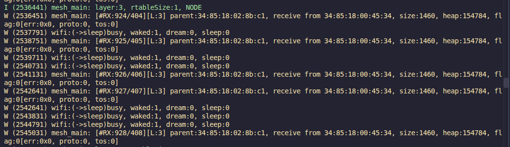

# Laboratorio de RPI I

Grupo: 7

Integrantes:

- Amirhosein Mozaffari

- Estefania Ruiz

- Sergio Romero Plasencia

Fecha: 01/11/2026

Número de laboratorio: 4

## Desarrollo de ejercicios

### Ejercicio 1

Captura el estado de la red cuando todos/as tus compañeros/as hayan llegado al estado de convergencia. Documenta el proceso y las salidas de tus nodos mesh, y representa la topología final mediante un grafo.

#### Estado de la red

Para comprobar la convergencia se dejó en ejecución el nodo mesh y se observaron periódicamente los mensajes del monitor serie. La red permaneció estable durante la captura: el dispositivo se mantuvo como `NODE` en la capa 2, utilizando como padre el nodo `34:85:18:01:71:a9`. Además, se recibieron de forma continua tramas de 1460 bytes desde `34:85:18:01:71:a8`, sin errores de protocolo (`err:0x0`).

El nodo estaba asociado en el canal 7, con una señal de recepción entre -54 dBm y -62 dBm. La asociación mostraba seis dispositivos (`assoc:6`), lo que confirma que el nodo formaba parte de la red mesh. Los mensajes de monitorización del padre también indican que el nodo conservaba su relación en la capa 2 y no necesitaba cambiar de padre.

Una parte representativa de la salida:

```text
I (296441) mesh_main: layer:2, rtableSize:1, NODE
W (297311) mesh_main: [#RX:126/472][L:2] parent:34:85:18:01:71:a9, receive from 34:85:18:01:71:a8, size=1460, heap:156184, flag:0[err:0x0, proto:0, tos:0]
I (306441) mesh_main: layer:2, rtableSize:1, NODE
I (388391) mesh: 5127<assoc>parent layer:1, channel:7, rssi:-62, assoc:6, rssi threshold<-78,-82,-85>
I (452491) mesh: 5161<active>parent layer:1(node), channel:7, rssi:-54, assoc:6(cnx rssi threshold:-120)my_assoc:0
W (454561) mesh_main: [#RX:184/529][L:2] parent:34:85:18:01:71:a9, receive from 34:85:18:01:71:a8, size=1460, heap:156184, flag:0[err:0x0, proto:0, tos:0]
```

#### Topologia

La topología final se representa en el siguiente grafo.

<div align="center">


*Diagrama de Red Mesh*

</div>

### Ejercicio 2 

Captura de nuevo el estado de la red cuando todos/as tus compañeros/as hayan llegado al estado de convergencia. Documenta el proceso y las salidas de tus nodos mesh, y representa la nueva topología final mediante un grafo.

#### Estado de la red

En esta segunda captura se dejó el nodo mesh en ejecución hasta que la red alcanzó de nuevo el estado de convergencia. A diferencia del ejercicio anterior, nuestro nodo se encontraba en la capa 3 (`layer:3`). Su padre directo era el nodo `34:85:18:02:8b:c1`, situado en la capa 2. A su vez, este nodo de capa 2 estaba conectado al padre de la red, `34:85:18:00:45:34`.

La estabilidad de la conexión se observa en la recepción consecutiva de tramas, cuyos contadores avanzan de `#RX:924/404` a `#RX:928/408`. Todas las tramas tenían un tamaño de 1460 bytes y se recibieron sin errores (`err:0x0`), por lo que la comunicación entre los niveles de la red era correcta.

Una parte representativa de la salida observada es:

```text
I (2536441) mesh_main: layer:3, rtableSize:1, NODE
W (2536451) mesh_main: [#RX:924/404][L:3] parent:34:85:18:02:8b:c1, receive from 34:85:18:00:45:34, size:1460, heap:154784, flag:0[err:0x0, proto:0, tos:0]
W (2537851) mesh_main: [#RX:925/405][L:3] parent:34:85:18:02:8b:c1, receive from 34:85:18:00:45:34, size:1460, heap:154784, flag:0[err:0x0, proto:0, tos:0]
W (2541131) mesh_main: [#RX:926/406][L:3] parent:34:85:18:02:8b:c1, receive from 34:85:18:00:45:34, size:1460, heap:154784, flag:0[err:0x0, proto:0, tos:0]
W (2543351) mesh_main: [#RX:927/407][L:3] parent:34:85:18:02:8b:c1, receive from 34:85:18:00:45:34, size:1460, heap:154784, flag:0[err:0x0, proto:0, tos:0]
W (2545031) mesh_main: [#RX:928/408][L:3] parent:34:85:18:02:8b:c1, receive from 34:85:18:00:45:34, size:1460, heap:154784, flag:0[err:0x0, proto:0, tos:0]
```

Por tanto, la nueva topología tiene tres niveles: el padre en la raíz, el nodo intermedio en la capa 2 y nuestro nodo en la capa 3. El grafo de la imagen representa esta relación jerárquica.


<div align="center">



</div>

#### Topologia

La topología final se representa en el siguiente grafo.

<div align="center">


*Diagrama de Red Mesh*

</div>

