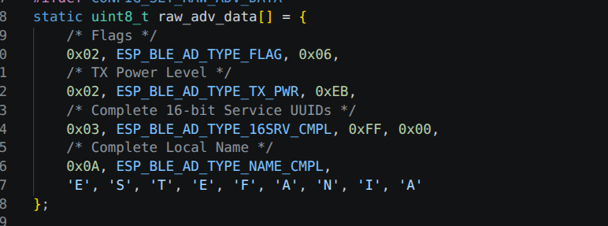
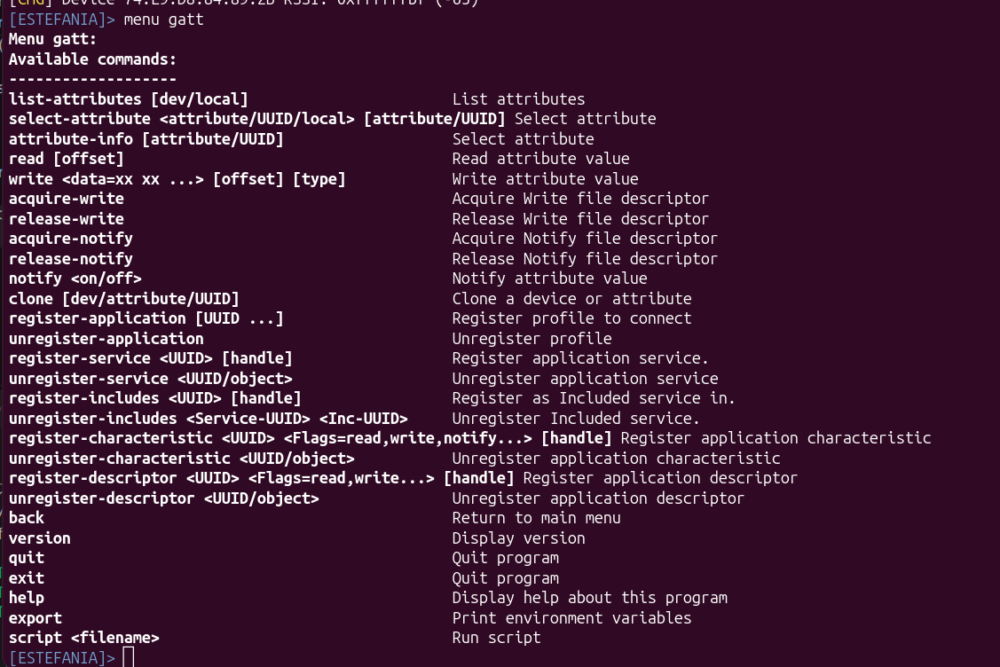
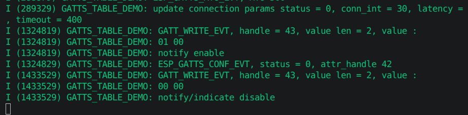

# Laboratorio de RPI I

Grupo: 7

Integrantes:

- Amirhosein Mozaffari

- Estefania Ruiz

- Sergio Romero Plasencia

Fecha: 22/11/2026

Número de laboratorio: 5

## Desarrollo de ejercicios

### Ejercicio 1

Modifica el código del ejemplo para cambiar el nombre del dispositivo que se enviará en cada anuncio emitido durante la fase de advertising. A continuación, compila y flashea la nueva versión, inicia otra sesión de escaneo y vuelve a localizar tu dispositivo. Anota su dirección Bluetooth.

*Cambio de nombre del dispositivo*

*Escaneo y conexión con el dispositivo*

*Respuesta del dispositivo despues de la conexión*

### Ejercicio 2

Establece la conexión con el servidor GATT y documenta el proceso, incluyendo los mensajes que muestra el ESP32.

*Ingreso al menú del servidor GATT*

##### Lista de atributos de GATT

[ESTEFANIA]> list-attributes
Primary Service (Handle 0x0001)
	/org/bluez/hci0/dev_24_0A_C4_EA_50_92/service0001
	00001801-0000-1000-8000-00805f9b34fb
	Generic Attribute Profile
Characteristic (Handle 0x0002)
	/org/bluez/hci0/dev_24_0A_C4_EA_50_92/service0001/char0002
	00002a05-0000-1000-8000-00805f9b34fb
	Service Changed
Descriptor (Handle 0x0004)
	/org/bluez/hci0/dev_24_0A_C4_EA_50_92/service0001/char0002/desc0004
	00002902-0000-1000-8000-00805f9b34fb
	Client Characteristic Configuration
Primary Service (Handle 0x0014)
	/org/bluez/hci0/dev_24_0A_C4_EA_50_92/service0014
	00001800-0000-1000-8000-00805f9b34fb
	Generic Access Profile
Characteristic (Handle 0x0015)
	/org/bluez/hci0/dev_24_0A_C4_EA_50_92/service0014/char0015
	00002a00-0000-1000-8000-00805f9b34fb
	Device Name
Characteristic (Handle 0x0017)
	/org/bluez/hci0/dev_24_0A_C4_EA_50_92/service0014/char0017
	00002a01-0000-1000-8000-00805f9b34fb
	Appearance
Characteristic (Handle 0x0019)
	/org/bluez/hci0/dev_24_0A_C4_EA_50_92/service0014/char0019
	00002aa6-0000-1000-8000-00805f9b34fb
	Central Address Resolution
Primary Service (Handle 0x0028)
	/org/bluez/hci0/dev_24_0A_C4_EA_50_92/service0028
	000000ff-0000-1000-8000-00805f9b34fb
	Unknown
Characteristic (Handle 0x0029)
	/org/bluez/hci0/dev_24_0A_C4_EA_50_92/service0028/char0029
	0000ff01-0000-1000-8000-00805f9b34fb
	Unknown
Descriptor (Handle 0x002b)
	/org/bluez/hci0/dev_24_0A_C4_EA_50_92/service0028/char0029/desc002b
	00002902-0000-1000-8000-00805f9b34fb
	Client Characteristic Configuration
Characteristic (Handle 0x002c)
	/org/bluez/hci0/dev_24_0A_C4_EA_50_92/service0028/char002c
	0000ff02-0000-1000-8000-00805f9b34fb
	Unknown
Characteristic (Handle 0x002e)
	/org/bluez/hci0/dev_24_0A_C4_EA_50_92/service0028/char002e
	0000ff03-0000-1000-8000-00805f9b34fb
	Unknown

##### Nombre del dispositivo Bluetooth configurado 

	[ESTEFANIA]> select-attribute /org/bluez/hci0/dev_24_0A_C4_EA_50_92/service0014/char0015
	[ESP_ESTEFANY:/service0014/char0015]> read
	Attempting to read /org/bluez/hci0/dev_24_0A_C4_EA_50_92/service0014/char0015
	[CHG] Attribute /org/bluez/hci0/dev_24_0A_C4_EA_50_92/service0014/char0015 Value:
	45 53 50 5f 45 53 54 45 46 41 4e 59              ESP_ESTEFANY    
	45 53 50 5f 45 53 54 45 46 41 4e 59              ESP_ESTEFANY 
	

##### Modificar las notificaciones

	[ESP_ESTEFANY:/service0014/char0015]> select-attribute /org/bluez/hci0/dev_24_0A_C4_EA_50_92/service0028/char0029
	[ESP_ESTEFANY:/service0028/char0029]> notify on
	[CHG] Attribute /org/bluez/hci0/dev_24_0A_C4_EA_50_92/service0028/char0029 Notifying: yes
	Notify started
	[CHG] Attribute /org/bluez/hci0/dev_24_0A_C4_EA_50_92/service0028/char0029 Value:
	00 01 02 03 04 05 06 07 08 09 0a 0b 0c 0d 0e     ............... 
	[ESP_ESTEFANY:/service0028/char0029]> notify off
	[CHG] Attribute /org/bluez/hci0/dev_24_0A_C4_EA_50_92/service0028/char0029 Notifying: no
	Notify stopped

  

*Respuesta del monitor esp32*

