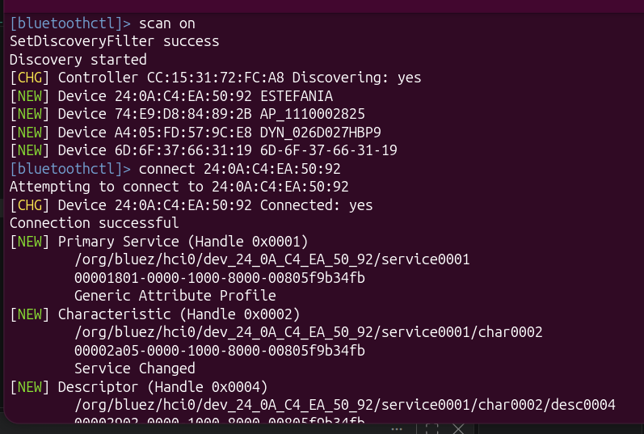
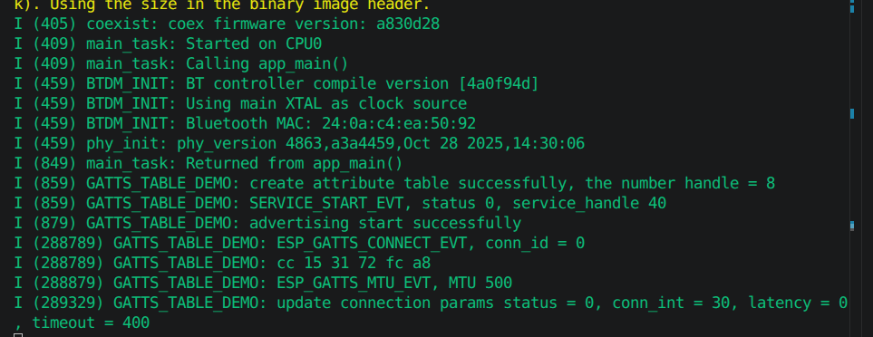
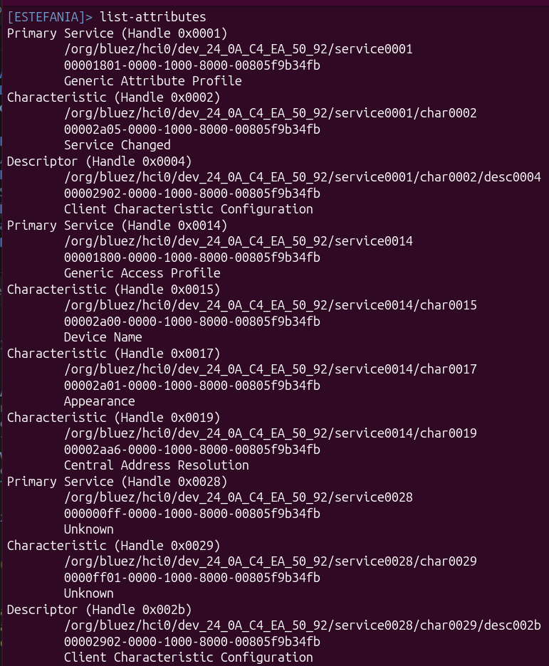
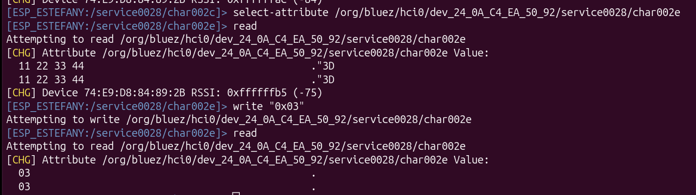
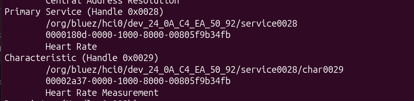
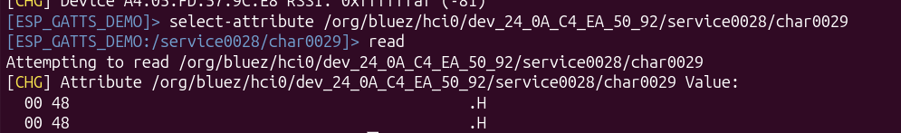

# Laboratorio de RPI I

Grupo: 7

Integrantes:

- Amirhosein Mozaffari

- Estefania Ruiz

- Sergio Romero Plasencia

Fecha: 22/11/2026

Número de laboratorio: 5

## Desarrollo de ejercicios

### Ejercicio 1

Modifica el código del ejemplo para cambiar el nombre del dispositivo que se enviará en cada anuncio emitido durante la fase de advertising. A continuación, compila y flashea la nueva versión, inicia otra sesión de escaneo y vuelve a localizar tu dispositivo. Anota su dirección Bluetooth.

*Cambio de nombre del dispositivo*

*Escaneo y conexión con el dispositivo*

*Respuesta del dispositivo despues de la conexión*

### Ejercicio 2

Establece la conexión con el servidor GATT y documenta el proceso, incluyendo los mensajes que muestra el ESP32.

*Ingreso al menú del servidor GATT*

*Lista de atributos de GATT*

##### Nombre del dispositivo Bluetooth configurado 

	[ESTEFANIA]> select-attribute /org/bluez/hci0/dev_24_0A_C4_EA_50_92/service0014/char0015
	[ESP_ESTEFANY:/service0014/char0015]> read
	Attempting to read /org/bluez/hci0/dev_24_0A_C4_EA_50_92/service0014/char0015
	[CHG] Attribute /org/bluez/hci0/dev_24_0A_C4_EA_50_92/service0014/char0015 Value:
	45 53 50 5f 45 53 54 45 46 41 4e 59              ESP_ESTEFANY    
	45 53 50 5f 45 53 54 45 46 41 4e 59              ESP_ESTEFANY 
	

##### Modificar las notificaciones

	[ESP_ESTEFANY:/service0014/char0015]> select-attribute /org/bluez/hci0/dev_24_0A_C4_EA_50_92/service0028/char0029
	[ESP_ESTEFANY:/service0028/char0029]> notify on
	[CHG] Attribute /org/bluez/hci0/dev_24_0A_C4_EA_50_92/service0028/char0029 Notifying: yes
	Notify started
	[CHG] Attribute /org/bluez/hci0/dev_24_0A_C4_EA_50_92/service0028/char0029 Value:
	00 01 02 03 04 05 06 07 08 09 0a 0b 0c 0d 0e     ............... 
	[ESP_ESTEFANY:/service0028/char0029]> notify off
	[CHG] Attribute /org/bluez/hci0/dev_24_0A_C4_EA_50_92/service0028/char0029 Notifying: no
	Notify stopped

  

*Respuesta del monitor esp32*

La característica FF03 pertenece a un servicio GATT personalizado de tu ESP32.

Su UUID completo es:
0000ff03-0000-1000-8000-00805f9b34fb

  

*Consulta su valor (read) y modificacion (write)*

### Ejercicio 3

Mediante el comando correspondiente, consulta e identifica manualmente los atributos/características de la tabla GATT de tu dispositivo

Una vez conectado al dispositivo, se ha ejecutado el comando:

list-attributes

Este comando permite visualizar los servicios primarios, las características asociadas y sus descriptores, identificados mediante sus respectivos UUID.

En el resultado obtenido se identifican los siguientes servicios:

-- Generic Attribute (0x1801): servicio que contiene la característica Service Changed (0x2A05).

-- Generic Access (0x1800): contiene las características Device Name (0x2A00), Appearance (0x2A01) y Central Address Resolution (0x2AA6).

-- Servicio personalizado (0x00FF): contiene las características 0xFF01, 0xFF02 y 0xFF03.

Además, se identifica el descriptor Client Characteristic Configuration (CCCD), con UUID 0x2902, utilizado para configurar las notificaciones e indicaciones de las características.

*Lista de atributos*

### Ejercicio 4

Identifica el UUID de la característica que nos permitirá leer el Heart Rate Measurement Value. ¿Con qué comandos podemos leer su valor? Obtén el valor y documenta el proceso seguido.

*Identificación de UUID*

*Lectura del valor*

Para realizar la lectura se utilizó la herramienta bluetoothctl de Linux. Primero se activó el Bluetooth y se realizó un escaneo para localizar la ESP32. A continuación, se estableció una conexión con el dispositivo mediante su dirección MAC.

Una vez conectado, se accedió al menú GATT mediante menu gatt y se ejecutó list-attributes para visualizar los servicios y características disponibles. Se identificó la característica Heart Rate Measurement con UUID 0x2A37.

Posteriormente, se seleccionó la característica mediante select-attribute, utilizando su ruta GATT, y se ejecutó el comando read para obtener su valor.

El resultado obtenido fue:

00 48

El primer byte (00) contiene los indicadores de la medición y el segundo byte (48) representa el ritmo cardíaco en hexadecimal. Al convertirlo a decimal se obtiene 72.

Por tanto, el valor leído es 72 pulsaciones por minuto (BPM).

Este valor es fijo y se ha configurado en el código de la ESP32 como dato de demostración, por lo que no procede de un sensor físico.