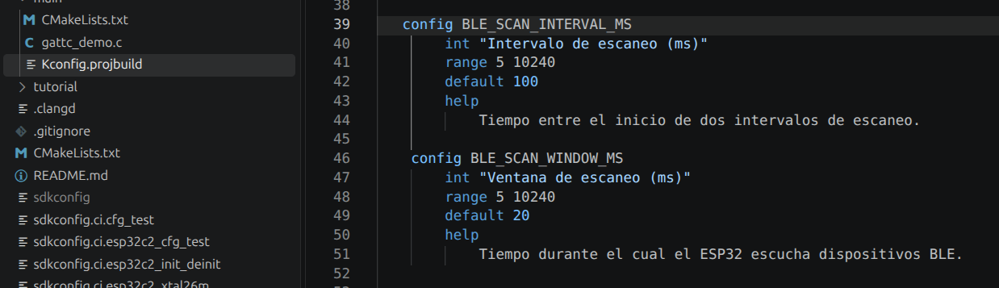
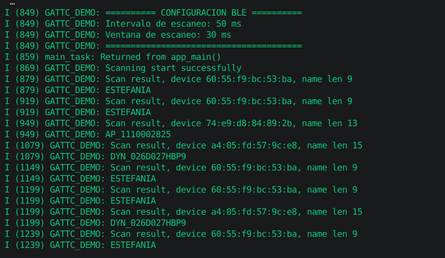
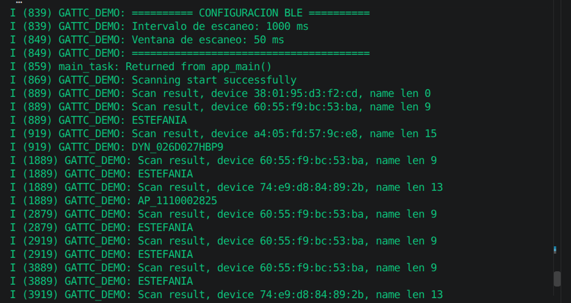
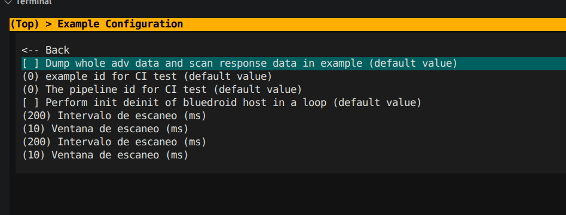
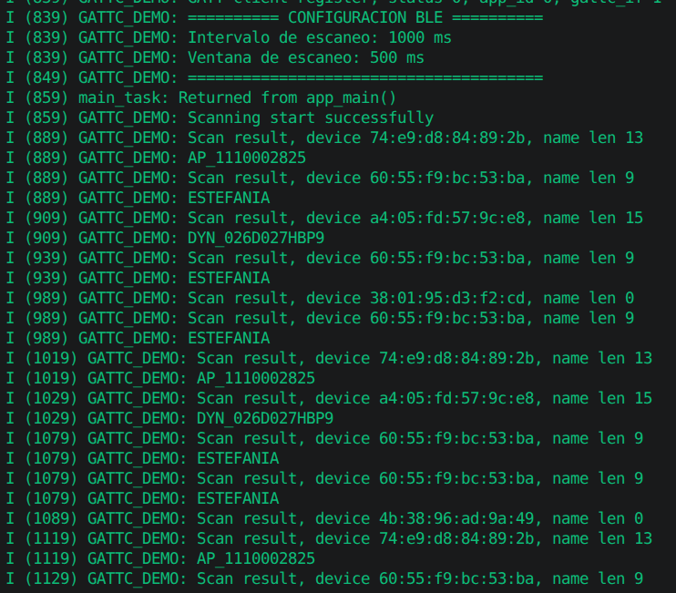
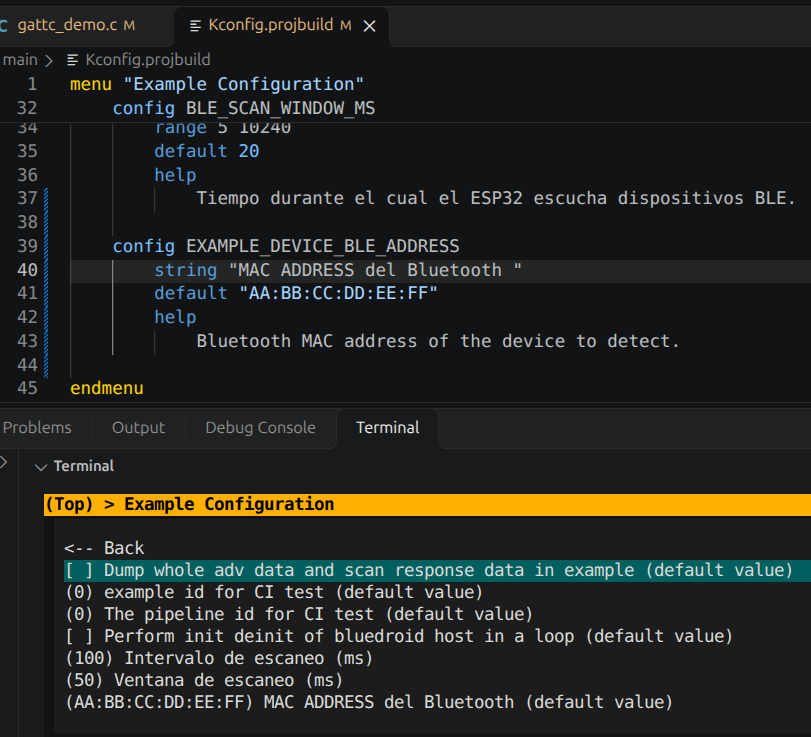
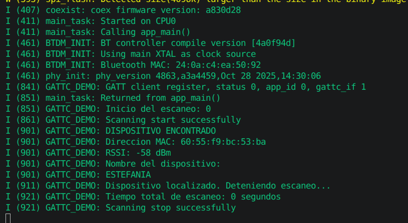

# Laboratorio de RPI I

Grupo: 7

Integrantes:

- Amirhosein Mozaffari

- Estefania Ruiz

- Sergio Romero Plasencia

Fecha: 29/11/2026

Número de laboratorio: 6

## Desarrollo de ejercicios

### Ejercicio 1

Modifica los parámetros de escaneo para que este se realice con menor frecuencia. Añade estos parámetros a través de menuconfig. ¿Qué diferencia hay entre el intervalo de escaneo y la ventana de escaneo? Muestra cómo cambia el comportamiento del escaneo al modificar ambos parámetros.

Se sustituye del ejemplo original:

	.scan_interval = ESP_BLE_GAP_SCAN_ITVL_MS(50),
	.scan_window = ESP_BLE_GAP_SCAN_WIN_MS(30),

Por:

	.scan_interval = ESP_BLE_GAP_SCAN_ITVL_MS(CONFIG_BLE_SCAN_INTERVAL_MS),
	.scan_window = ESP_BLE_GAP_SCAN_WIN_MS(CONFIG_BLE_SCAN_WINDOW_MS),

Se añade en el Kconfig.projbuild

Después en el código del cliente.c

```c
static esp_ble_scan_params_t ble_scan_params = {

.scan_type = BLE_SCAN_TYPE_ACTIVE,

.own_addr_type = BLE_ADDR_TYPE_PUBLIC,

.scan_filter_policy = BLE_SCAN_FILTER_ALLOW_ALL,

.scan_interval = ESP_BLE_GAP_SCAN_ITVL_MS(

CONFIG_BLE_SCAN_INTERVAL_MS

),
.scan_window = ESP_BLE_GAP_SCAN_WIN_MS(

CONFIG_BLE_SCAN_WINDOW_MS
),
.scan_duplicate = BLE_SCAN_DUPLICATE_DISABLE
};
```

</div>

<div align="center">



*Parámetros para cambio de intervalo de escaneo y ventana de escaneo*

</div>


</div>

<div align="center">


*Menuconfig para cambio de parámetros*

</div>

¿Qué diferencia hay entre el intervalo de escaneo y la ventana de escaneo?

La diferencia radica en que el intervalo marca cada cuánto tiempo empieza un ciclo de búsqueda, mientras que la ventana define cuánto tiempo pasa la radio realmente encendida escuchando dentro de ese ciclo:
Intervalo de escaneo (scan_interval): Es el periodo total que transcurre desde que comienza un escaneo en un canal de anuncio (37, 38 o 39) hasta que arranca el siguiente ciclo en el siguiente canal. Determina la frecuencia con la que el cliente inicia la búsqueda.
Ventana de escaneo (scan_window): Es el tiempo efectivo dentro de cada intervalo durante el cual el receptor Bluetooth permanece activo capturando paquetes de advertising. 

### Tabla de pruebas y valores

| Configuración | Intervalo (`scan_interval`) | Ventana (`scan_window`) | Ciclo de trabajo (Duty Cycle) | Comportamiento observado |
| :--- | :--- | :--- | :--- | :--- |
| **Original (Rápido)** | $50\text{ ms}$ (`80`) | $30\text{ ms}$ (`48`) | $60\%$ | **Detección casi inmediata** (decenas de milisegundos). Alto consumo energético porque la radio pasa más de la mitad del tiempo escuchando. |
| **Baja frecuencia / Ventana corta** | $1000\text{ ms}$ (`1600`) | $50\text{ ms}$ (`80`) | $5\%$ | **Detección lenta / errática.** El cliente tarda varios segundos en encontrar al ESP32-C3 porque pasa $950\text{ ms}$ "dormido" por cada segundo y puede perder paquetes de anuncio. Consumo muy bajo. |
| **Baja frecuencia / Ventana amplia** | $1000\text{ ms}$ (`1600`) | $500\text{ ms}$ (`800`) | $50\%$ | **Detección moderada.** Aunque la frecuencia de inicio es baja (1 vez por segundo), al mantener la ventana abierta medio segundo tiene alta probabilidad de capturar el anuncio del servidor en el primer o segundo intento. |
| **Escaneo Continuo** | $1000\text{ ms}$ (`1600`) | $1000\text{ ms}$ (`1600`) | $100\%$ | **Sin pausas.** La radio escucha el $100\%$ del tiempo, cambiando de canal cada $1000\text{ ms}$. Máximo consumo de batería y máxima probabilidad de detección. |

#### Prueba 1

<div align="center">


*Prueba con valores default*
</div>

<div align="center">



*Prueba con valores default*
</div>


#### Prueba 2

</div>

<div align="center">


*Respuesta a menor frecuencia*

</div>

</div>

<div align="center">



*Respuesta a menor frecuencia*

</div>


En esta prueba el ESP32 pasa menos tiempo escuchando: aproximadamente el 15 %.

#### Prueba 3

</div>

<div align="center">



*Baja frecuencia / Ventana amplia*

</div>

</div>

<div align="center">



*Baja frecuencia / Ventana amplia*

</div>

#### Prueba 4

</div>

<div align="center">


*Escaneo Continuo*

</div>


</div>

<div align="center">


*Escaneo Continuo*

</div>


### Ejercicio 2

¿Por qué llega un momento en el que el escaneo se detiene? Analiza el código y modifícalo para que el proceso de escaneo se realice indefinidamente. Comprueba que el tiempo durante el cual el dispositivo permanece en fase de escaneo corresponde al valor seleccionado.

El escaneo se detiene por dos razones
1.- En la función esp_gap_cb(), dentro del evento ESP_GAP_BLE_SCAN_PARAM_SET_COMPLETE_EVT, define los siguiente:

```c
case ESP_GAP_BLE_SCAN_PARAM_SET_COMPLETE_EVT: {
    // The unit of duration is seconds.
    // If duration is set to 0, scanning will continue indefinitely
    // until esp_ble_gap_stop_scanning is explicitly called.
    uint32_t duration = 30;
    esp_ble_gap_start_scanning(duration);
    break;
}
```
Al pasar duration = 30, la pila BLE de ESP-IDF inicia un temporizador interno de 30 segundos. Si durante ese tiempo no encuentra el servidor, el escaneo se detiene automáticamente y dispara el evento ESP_GAP_BLE_SCAN_STOP_COMPLETE_EVT.

2.- Por detención explícita al encontrar el dispositivo:
Dentro de ESP_GAP_BLE_SCAN_RESULT_EVT, cuando el cliente detecta un anuncio cuyo nombre coincide con "ESP_GATTESTEFY", ejecuta explícitamente esp_ble_gap_stop_scanning(); justo antes de iniciar la conexión GATT (esp_ble_gattc_enh_open).


#### Modicar el codigo 

##### Cambio de la duración a 0

```c
static void esp_gap_cb(esp_gap_ble_cb_event_t event, esp_ble_gap_cb_param_t *param)

{

uint8_t *adv_name = NULL;

uint8_t adv_name_len = 0;

switch (event) {

case ESP_GAP_BLE_SCAN_PARAM_SET_COMPLETE_EVT: {

uint32_t duration = 0;

ESP_LOGI(GATTC_TAG, "Iniciando escaneo indefinido");

esp_ble_gap_start_scanning(duration);

break;

}
```

##### Marca de tiempo para comprobar la duración real

El escaneo es indefinido hasta encontrar el dispositivo 


<div align="center">


*Tiempo total de scaneo*

</div>

### Ejercicio 3

Muestra también por pantalla el valor del RSSI de cada dispositivo BLE detectado.

Dentro del case ESP_GAP_SEARCH_INQ_RES_EVT; se coloca el siguiente codigo para visualizar lo solicitado en el ejercicio:

```c
ESP_LOGI(GATTC_TAG, "Scan result, device "ESP_BD_ADDR_STR", name len %u", ESP_BD_ADDR_HEX(scan_result->scan_rst.bda), adv_name_len);

ESP_LOG_BUFFER_CHAR(GATTC_TAG, adv_name, adv_name_len);

// Mostrar RSSI de cada dispositivo BLE detectado
ESP_LOGI(GATTC_TAG, "RSSI: %d dBm", scan_result->scan_rst.rssi);
```

Este evento se ejecuta cada vez que se detecta un dispositivo BLE. Por tanto, al colocar ahí la instrucción ESP_LOGI(), se mostrará el RSSI de cada dispositivo detectado, no solamente el del servidor GATT al que nos conectamos.

<div align="center">


*RSSI parametro añadido al escaneo*

</div>

### Ejercicio 4

Añade a menuconfig un campo que permita configurar la dirección Bluetooth de un dispositivo conocido. Modifica el código para que únicamente se muestre la información del dispositivo cuya dirección se haya configurado.

Se crea la opcion requerida por el ejercicio en Kconfig 


<div align="center">



*Campo para ingresar la MAC*

</div>

<div align="center">


*Mac del dispositivo servidor*

</div>


Código que se cambio en la busqueda
```c

case 

ESP_GAP_SEARCH_INQ_RES_EVT: {

    // Evitar procesar nuevos resultados si ya encontramos el dispositivo
    if (dispositivo_encontrado) {
        break;
    }

    // Obtener la MAC configurada en menuconfig
    unsigned int mac[6];

    if (sscanf(CONFIG_EXAMPLE_DEVICE_BLE_ADDRESS,
               "%x:%x:%x:%x:%x:%x",
               &mac[0], &mac[1], &mac[2],
               &mac[3], &mac[4], &mac[5]) != 6) {
        ESP_LOGE(GATTC_TAG, "Direccion MAC no valida");
        break;
    }

    // Comparar las direcciones MAC
    bool match = true;

    for (int i = 0; i < 6; i++) {
        if (scan_result->scan_rst.bda[i] != mac[i]) {
            match = false;
            break;
        }
    }

    // Si no coincide, ignorar el dispositivo
    if (!match) {
        break;
    }

    // Dispositivo encontrado
    dispositivo_encontrado = true;

    ESP_LOGI(GATTC_TAG, "DISPOSITIVO ENCONTRADO");

    ESP_LOGI(GATTC_TAG, "Direccion MAC: "ESP_BD_ADDR_STR,
             ESP_BD_ADDR_HEX(scan_result->scan_rst.bda));

    // Mostrar RSSI
    ESP_LOGI(GATTC_TAG, "RSSI: %d dBm",
             scan_result->scan_rst.rssi);

    // Obtener nombre del dispositivo
    adv_name = esp_ble_resolve_adv_data_by_type(
        scan_result->scan_rst.ble_adv,
        scan_result->scan_rst.adv_data_len +
        scan_result->scan_rst.scan_rsp_len,
        ESP_BLE_AD_TYPE_NAME_CMPL,
        &adv_name_len);

    if (adv_name != NULL) {
        ESP_LOGI(GATTC_TAG, "Nombre del dispositivo:");
        ESP_LOG_BUFFER_CHAR(GATTC_TAG, adv_name, adv_name_len);
    }

#if CONFIG_EXAMPLE_DUMP_ADV_DATA_AND_SCAN_RESP

    if (scan_result->scan_rst.adv_data_len > 0) {
        ESP_LOGI(GATTC_TAG, "adv data:");
        ESP_LOG_BUFFER_HEX(GATTC_TAG,
                           &scan_result->scan_rst.ble_adv[0],
                           scan_result->scan_rst.adv_data_len);
    }

    if (scan_result->scan_rst.scan_rsp_len > 0) {
        ESP_LOGI(GATTC_TAG, "scan resp:");
        ESP_LOG_BUFFER_HEX(GATTC_TAG,
                           &scan_result->scan_rst.ble_adv[scan_result->scan_rst.adv_data_len],
                           scan_result->scan_rst.scan_rsp_len);
    }

#endif

    // Detener el escaneo al encontrar el dispositivo
    ESP_LOGI(GATTC_TAG, "Dispositivo localizado. Deteniendo escaneo...");

    esp_ble_gap_stop_scanning();

    break;
}

```

<div align="center">



*Características del dispositivo con la mac seleccionada*

</div>

### Ejercicio 5
Modifica el código para que, en función del valor de RSSI obtenido para el dispositivo de interés, el cliente muestre por pantalla un indicador proporcional a la distancia aproximada a dicho dispositivo (por ejemplo, un número concreto de puntos según la distancia). Para ello, establece un valor mínimo y otro máximo de RSSI y aplica la siguiente fórmula: (RSSI - RSSI_MIN) / (RSSI_MAX - RSSI_MIN). Prueba a alejar físicamente los dispositivos entre sí.