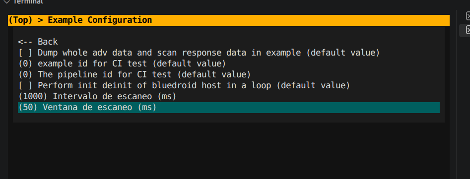
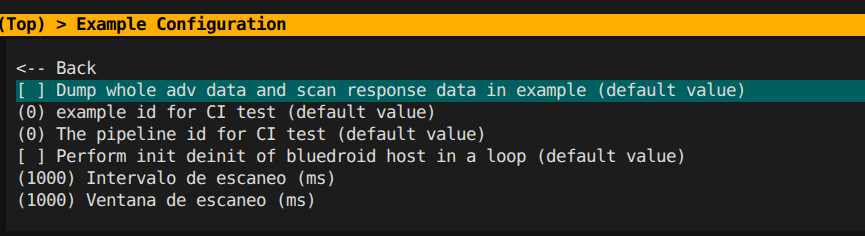
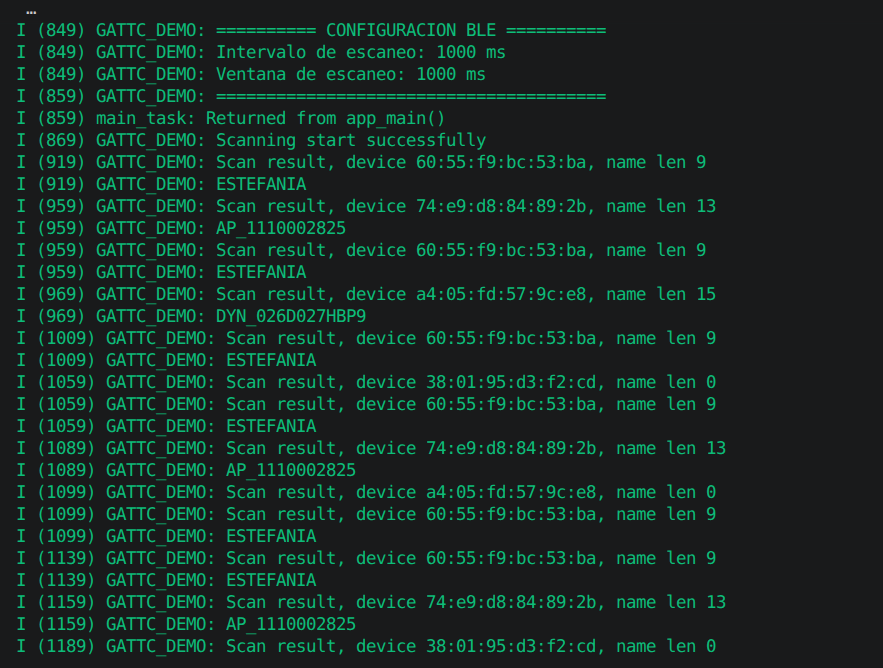
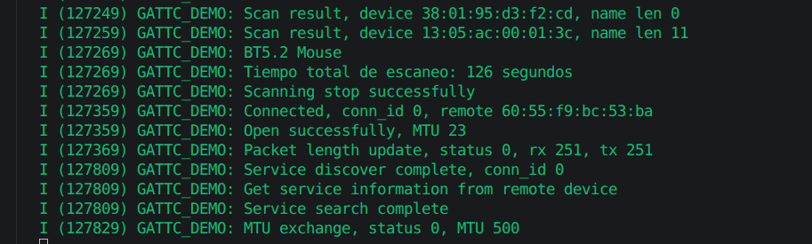
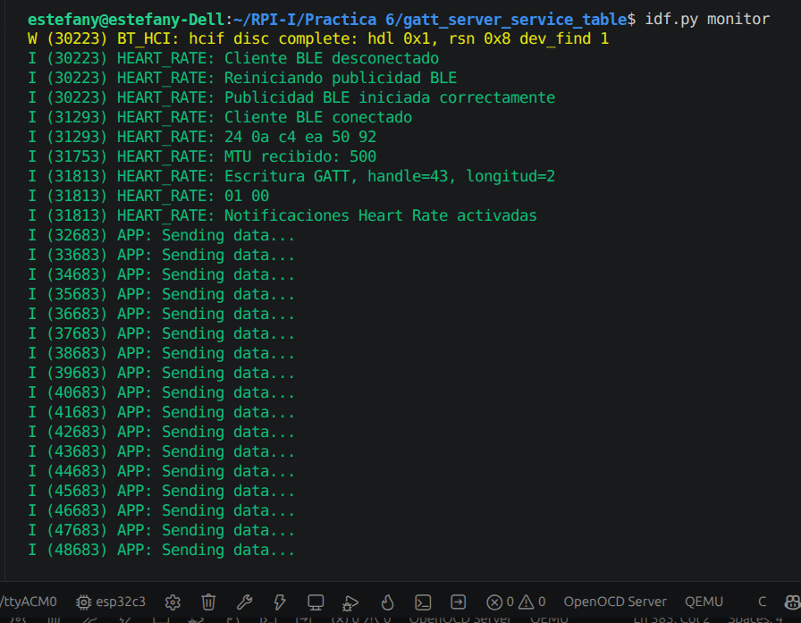

# Laboratorio de RPI I

Grupo: 7

Integrantes:

- Amirhosein Mozaffari

- Estefania Ruiz

- Sergio Romero Plasencia

Fecha: 29/11/2026

Número de laboratorio: 6

## Desarrollo de ejercicios

### Ejercicio 1

Modifica los parámetros de escaneo para que este se realice con menor frecuencia. Añade estos parámetros a través de menuconfig. ¿Qué diferencia hay entre el intervalo de escaneo y la ventana de escaneo? Muestra cómo cambia el comportamiento del escaneo al modificar ambos parámetros.

Se sustituye del ejemplo original:

.scan_interval = ESP_BLE_GAP_SCAN_ITVL_MS(50),
.scan_window = ESP_BLE_GAP_SCAN_WIN_MS(30),

Por:

.scan_interval = ESP_BLE_GAP_SCAN_ITVL_MS(CONFIG_BLE_SCAN_INTERVAL_MS),
.scan_window = ESP_BLE_GAP_SCAN_WIN_MS(CONFIG_BLE_SCAN_WINDOW_MS),

Se añade en el Kconfig.projbuild

*Parámetros para cambio de intervalo de escaneo y ventana de escaneo*

div align="center">

*Menuconfig para cambio de parámetros*

| Configuración | Intervalo (`scan_interval`) | Ventana (`scan_window`) | Ciclo de trabajo (Duty Cycle) | Comportamiento observado |
| :--- | :--- | :--- | :--- | :--- |
| **Original (Rápido)** | $50\text{ ms}$ (`80`) | $30\text{ ms}$ (`48`) | $60\%$ | **Detección casi inmediata** (decenas de milisegundos). Alto consumo energético porque la radio pasa más de la mitad del tiempo escuchando. |
| **Baja frecuencia / Ventana corta** | $1000\text{ ms}$ (`1600`) | $50\text{ ms}$ (`80`) | $5\%$ | **Detección lenta / errática.** El cliente tarda varios segundos en encontrar al ESP32-C3 porque pasa $950\text{ ms}$ "dormido" por cada segundo y puede perder paquetes de anuncio. Consumo muy bajo. |
| **Baja frecuencia / Ventana amplia** | $1000\text{ ms}$ (`1600`) | $500\text{ ms}$ (`800`) | $50\%$ | **Detección moderada.** Aunque la frecuencia de inicio es baja (1 vez por segundo), al mantener la ventana abierta medio segundo tiene alta probabilidad de capturar el anuncio del servidor en el primer o segundo intento. |
| **Escaneo Continuo** | $1000\text{ ms}$ (`1600`) | $1000\text{ ms}$ (`1600`) | $100\%$ | **Sin pausas.** La radio escucha el $100\%$ del tiempo, cambiando de canal cada $1000\text{ ms}$. Máximo consumo de batería y máxima probabilidad de detección. |

#### Prueba 1

*Prueba con valores default*

#### Prueba 2 menor frecuencia

*Respuesta a menor frecuencia*

*Respuesta a menor frecuencia*

En esta prueba el ESP32 pasa menos tiempo escuchando: aproximadamente el 15 %.

#### Prueba de redución de la ventana

*Variacion de valores*

*Variacion de valores*

Ahora el ESP32 escucha solamente durante aproximadamente el 5 % del tiempo.

### Ejercicio 2

Establece la conexión con el servidor GATT y documenta el proceso, incluyendo los mensajes que muestra el ESP32.

*Ingreso al menú del servidor GATT*

*Lista de atributos de GATT*

##### Nombre del dispositivo Bluetooth configurado 

	[ESTEFANIA]> select-attribute /org/bluez/hci0/dev_24_0A_C4_EA_50_92/service0014/char0015
	[ESP_ESTEFANY:/service0014/char0015]> read
	Attempting to read /org/bluez/hci0/dev_24_0A_C4_EA_50_92/service0014/char0015
	[CHG] Attribute /org/bluez/hci0/dev_24_0A_C4_EA_50_92/service0014/char0015 Value:
	45 53 50 5f 45 53 54 45 46 41 4e 59              ESP_ESTEFANY    
	45 53 50 5f 45 53 54 45 46 41 4e 59              ESP_ESTEFANY 
	

##### Modificar las notificaciones

	[ESP_ESTEFANY:/service0014/char0015]> select-attribute /org/bluez/hci0/dev_24_0A_C4_EA_50_92/service0028/char0029
	[ESP_ESTEFANY:/service0028/char0029]> notify on
	[CHG] Attribute /org/bluez/hci0/dev_24_0A_C4_EA_50_92/service0028/char0029 Notifying: yes
	Notify started
	[CHG] Attribute /org/bluez/hci0/dev_24_0A_C4_EA_50_92/service0028/char0029 Value:
	00 01 02 03 04 05 06 07 08 09 0a 0b 0c 0d 0e     ............... 
	[ESP_ESTEFANY:/service0028/char0029]> notify off
	[CHG] Attribute /org/bluez/hci0/dev_24_0A_C4_EA_50_92/service0028/char0029 Notifying: no
	Notify stopped

  

*Respuesta del monitor esp32*

La característica FF03 pertenece a un servicio GATT personalizado de tu ESP32.

Su UUID completo es:
0000ff03-0000-1000-8000-00805f9b34fb

  

*Consulta su valor (read) y modificacion (write)*

### Ejercicio 3

Mediante el comando correspondiente, consulta e identifica manualmente los atributos/características de la tabla GATT de tu dispositivo

Una vez conectado al dispositivo, se ha ejecutado el comando:

list-attributes

Este comando permite visualizar los servicios primarios, las características asociadas y sus descriptores, identificados mediante sus respectivos UUID.

En el resultado obtenido se identifican los siguientes servicios:

-- Generic Attribute (0x1801): servicio que contiene la característica Service Changed (0x2A05).

-- Generic Access (0x1800): contiene las características Device Name (0x2A00), Appearance (0x2A01) y Central Address Resolution (0x2AA6).

-- Servicio personalizado (0x00FF): contiene las características 0xFF01, 0xFF02 y 0xFF03.

Además, se identifica el descriptor Client Characteristic Configuration (CCCD), con UUID 0x2902, utilizado para configurar las notificaciones e indicaciones de las características.

*Lista de atributos*

### Ejercicio 4

Identifica el UUID de la característica que nos permitirá leer el Heart Rate Measurement Value. ¿Con qué comandos podemos leer su valor? Obtén el valor y documenta el proceso seguido.

*Identificación de UUID*

*Lectura del valor*

Para realizar la lectura se utilizó la herramienta bluetoothctl de Linux. Primero se activó el Bluetooth y se realizó un escaneo para localizar la ESP32. A continuación, se estableció una conexión con el dispositivo mediante su dirección MAC.

Una vez conectado, se accedió al menú GATT mediante menu gatt y se ejecutó list-attributes para visualizar los servicios y características disponibles. Se identificó la característica Heart Rate Measurement con UUID 0x2A37.

Posteriormente, se seleccionó la característica mediante select-attribute, utilizando su ruta GATT, y se ejecutó el comando read para obtener su valor.

El resultado obtenido fue:

00 48

El primer byte (00) contiene los indicadores de la medición y el segundo byte (48) representa el ritmo cardíaco en hexadecimal. Al convertirlo a decimal se obtiene 72.

Por tanto, el valor leído es 72 pulsaciones por minuto (BPM).

Este valor es fijo y se ha configurado en el código de la ESP32 como dato de demostración, por lo que no procede de un sensor físico.

### Ejercicio 5

Cambiamos el valor del variable y una vez que se haya hecho Build, Flash y Monitor, vamos a comprobar el cambio.

*Cambiar el valor*

*Comprobar el cambio*

### Ejercicio 6

Vamos a intentar a hacer "Write" para el valor de "heart_rate_measurment". Para esto, primero hay que añadir la autorización para poder escribir o cambiar este valor. 

*añadir el permiso de Write*

Ahora solo se trata de escribir un nuevo valor usando "bluetoothctl"

Vemos que hemos podido cambiar el valor sin problema.

### Ejercicio 7

Para hacer esto, se debe dar el valor 0x0001 al CCCD, que se va traducir al "0x01 0x00" en "little-endian".

Primero creamos una nueva variable global para el estado de la notificación (activo o desactivo), y añadimos su interacción dentro del evento de Write.

*Implementar la interacción*

A guardar los cambios y flashearlos, vamos a seleccionar el valor de "heart rate" y activar la notificación. Se puede comprobar esta activación usando un Read para el atributo de CCCD

*Activar y comprobar la notificación*

Se ve la activación correcta de la notificación tanto en la interfaz de "bluetoothctl" como en el terminal del dispositivo.

*El terminal de esp32*

### Ejercicio 8

A parte de cambiar la variable de "heart_rate_measurement" para que sea cambiable y también crear unas nuevas para ver el estado de la conección, hay que añanir y implementar un "handler" nuevo para hacer el loop principal de enviar este "heart rate" periódicamente.

*El handler principal*

Así, podemos enviar y recibir un valor random de "heart rate" cada segundo una vez que activamos la notificación de este valor.

*Activando la notificación*

*El dispositivo enviando mensajes*

También podemos desactivar esta interacción y el envio de los mensajes cuando queramos.

*Desactivar la notificación*

*El terminal de esp32*

